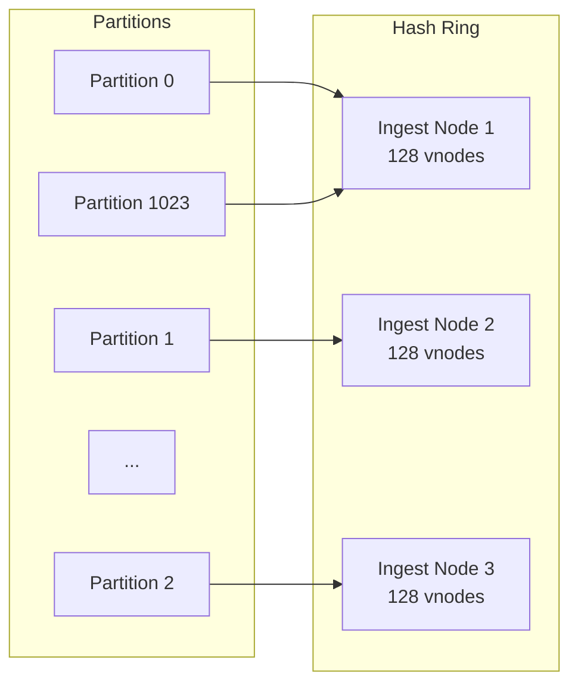
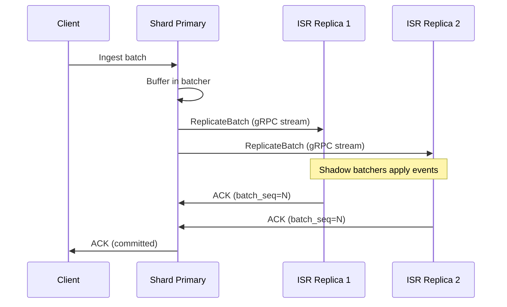

# Distributed Architecture

`pkg/cluster` holds the components of a multi-node LynxDB built on shared storage: S3 is the source of truth for segment data, so compute nodes hold no data that cannot be recovered. The packages contain Raft-backed metadata services, time+hash sharding, batch replication, rebalancing, and a distributed query planner and coordinator.

:::caution Cluster runtime
`lynxdb server` validates the `cluster` section of the configuration, but it does not start the cluster runtime: it opens no gRPC listener, joins no Raft group, and routes no shards. Every server runs as a single node. The sections below describe the cluster components in `pkg/cluster`.
:::

## Cluster Topology

```
┌──────────────────┐    ┌──────────────┐    ┌──────────────┐
│   Meta Nodes     │    │ Ingest Nodes │    │ Query Nodes  │
│   (3-5, Raft)    │    │ (N)          │    │ (M)          │
│                  │    │              │    │              │
│ - Shard map      │    │ - Batcher    │    │ - Scatter-   │
│ - Node registry  │    │ - Part flush │    │   gather     │
│ - Leases         │    │ - Upload S3  │    │ - Partial    │
│ - Field catalog  │    │ - Replicate  │    │   merge      │
│ - Source registry│    │              │    │ - Seg. cache │
└──────┬───────────┘    └──────┬───────┘    └──────┬───────┘
       │                       │                   │
       └───────────────────────┼───────────────────┘
                         ┌─────┴─────┐
                         │  S3/MinIO │
                         │ (source   │
                         │  of truth)│
                         └───────────┘
```

## Node Roles

The cluster has three roles. In small clusters (fewer than 10 nodes), every node runs all three. At scale, the roles run on separate nodes so each scales on its own.

### Meta Nodes (3-5)

Meta nodes manage cluster coordination and metadata:

- **Raft consensus**: Meta nodes form a Raft group (`hashicorp/raft`) that maintains a replicated state machine.
- **Shard map**: Records which ingest node owns which shard (partition). Each assignment carries a primary, replicas, a lifecycle state (`active`/`draining`/`migrating`/`splitting`), and an epoch counter. Changes go through Raft.
- **Node registry**: Tracks live nodes, their roles, health state (`alive`/`suspect`/`dead`), and resource use (CPU, memory, disk, ingest rate, active queries).
- **Leader leases**: Shard primaries hold renewable leases that prevent split-brain writes. The meta leader grants leases through Raft; a primary whose lease expired stops writing.
- **Failure detection**: Moves unresponsive nodes through `Alive → Suspect → Dead` on heartbeat timeouts.
- **Catalogs**: The state machine also stores the global field catalog and source registry (see [Distributed Subsystems](#distributed-subsystems)).

Meta nodes are lightweight. Three nodes tolerate one failure; five tolerate two. Meta nodes neither store nor query log data.

### Ingest Nodes (N)

Ingest nodes handle the write path:

1. Receive ingest requests (REST API and compatibility endpoints).
2. Route events to their shard with the [two-level sharding scheme](#sharding).
3. Buffer events in the `AsyncBatcher`, the same direct-to-part model as single-node mode.
4. When the batcher reaches its size or idle threshold, write a temporary `.lsg` file, fsync it, and rename it into the shard directory.
5. Upload the part to S3.
6. Replicate batches to ISR peers over gRPC streams (see [Replication](#replication)).

After a flush, an ingest node holds nothing that S3 does not. If an ingest node fails, its replicated batches are recovered from ISR peers and its shards move to another ingest node within about 25 seconds.

### Query Nodes (M)

Query nodes handle the read path:

1. Receive query requests through the REST API.
2. Compile the PPL query to an optimized IR plan and derive its storage hints (see [Query Engine](/docs/architecture/query-engine)).
3. Select the relevant shards from the time range and source scope of the hints.
4. Split the plan and send the query to the shard owners over gRPC.
5. Merge the shard results and run the rest of the plan.
6. Return the result, with partial-result metadata when some shards fail.

Query nodes keep a **local segment cache** so they do not download the same segments from S3 repeatedly. They also receive field catalog and source registry updates piggybacked on the shard map watch stream.

## Sharding

Data is partitioned across ingest nodes with a **two-level scheme**: time bucketing, then hash partitioning.

### Two-Level Scheme

```
┌─────────────────────────────────────────────────────────┐
│ Level 1 (Time):  ts.Truncate(TimeBucketSize)            │
│                  Default: 24h → one bucket per day       │
│                  Configurable: 1h, 6h, 24h               │
│                                                          │
│ Level 2 (Hash):  xxhash64(source + "\x00" + host)       │
│                  mod VirtualPartitionCount (default 1024) │
│                                                          │
│ ShardID:  "<index>/t<date>/p<partition>"                  │
│           e.g., "main/t2026-03-09/p42"                   │
└─────────────────────────────────────────────────────────┘
```

**Level 1 (time bucketing)**: The event timestamp is truncated to a `TimeBucketSize` boundary (1h, 6h, or 24h; default 24h), so a time-bounded query skips whole buckets outside its window.

**Level 2 (hash partitioning)**: Within each bucket, `xxhash64(source + "\x00" + host)` selects one of `VirtualPartitionCount` partitions (default 1024). The null byte separator keeps different `source`/`host` pairs from hashing the same concatenated key.

Time buckets prune shards for time-range queries; hash partitions spread the write load inside a bucket.

### Consistent Hash Ring

Partitions are assigned to ingest nodes with a consistent hash ring of **128 virtual nodes per physical node**. This gives:

- even load across nodes
- few partition moves when nodes join or leave (about 1/N of the partitions)
- the same assignment on every cluster member



### Partition Splitting

When a partition becomes a hot spot (ingest rate above a threshold, default 50,000 events/sec), LynxDB splits it into two children by **hash-bit subdivision**:

1. The splitter examines one more bit of the original hash value.
2. Events whose bit is 0 go to child A; events whose bit is 1 go to child B.
3. Existing data is not rehashed: old segments stay readable under the parent prefix.
4. A `SplitRegistry` records the split, and the router consults it when assigning events.

Split lifecycle: `ShardActive → ShardSplitting → children ShardMigrating → children ShardActive → parent removed`.

See [Rebalancing and Splitting](/docs/operations/rebalancing) for operational details.

## Replication

Cluster mode replicates the batcher: single-node and cluster ingest share the batcher-first write path, and the cluster streams batches to replicas on top of it.

### How Batcher Replication Works



1. The **primary** of each shard buffers events in its batcher and streams batches to every ISR replica.
2. Each batch carries a **sequence number** from the `BatchSequencer`, so replicas detect and discard duplicates on replay.
3. When the client gets its acknowledgement depends on the **ACK level**:
   - `none`: immediately (fastest, least durable).
   - `one` (default): after the primary commits the batch locally.
   - `all`: after every ISR replica acknowledged (most durable).
4. A replica that falls behind is removed from the ISR set by a Raft command.
5. When the primary fails, the meta leader promotes an ISR replica.

### Leader Leases

Leader leases keep two nodes from both acting as primary for the same shard:

- The shard primary renews its lease with the meta leader through the `RenewLease` RPC.
- The lease lasts `lease_duration` (default 10 seconds).
- A primary that cannot renew its lease (network partition, meta unavailable) stops accepting writes, except in meta-loss mode (see [Meta Node Failure](#meta-node-failure)).
- The meta leader does not assign the shard to a new primary until the old lease expires.

### Replication Factor

The replication factor (default 1, no replication; use 3 in production) sets the ISR size:

| Replication Factor | Minimum Nodes | Tolerated Failures |
|-------------------|--------------|--------------------|
| 1 | 1 | 0 (no replication) |
| 2 | 2 | 0 (one must be in sync) |
| 3 | 3 | 1 |

## Distributed Query Execution

In the design in `pkg/cluster/query`, a query node compiles the query into one optimized IR plan, exactly as a single node does, and `ir_planner.go` splits that plan between the shards and the coordinator. Shards receive only the query text: each one compiles it, derives the same split, and runs its part over local data.

### What the Planner Distributes

The planner accepts only a plan that is **one chain of operators over one scan**. It walks the chain from the scan upward:

1. **Shard prefix**: the longest run of row-local operators directly above the scan. Row-local operators map each row on its own, so they give the same result on each shard's rows as on all rows: `Filter` (search terms, `where`, `regex`), `Compute` (`eval`, `spath`), `Project` (`fields`), `RenameColumns` (`rename`), `Extract` (`parse`, `grok`, `rex`), `Unnest` (`expand`, `mvexpand`) and `FlattenObject` (`flatten`). Every shard runs this prefix and its scan with the plan's storage hints.
2. **Partial aggregation**: when the first operator after the prefix is a `stats` whose group keys are plain fields and whose aggregations are `count`, `sum`, `avg`, `min` or `max` over plain fields, shards compute mergeable partial states (for `avg`, a sum and a count per group) and the coordinator merges them.
3. **Top-K merge**: when that aggregation is followed by a `TopN` (from `sort ... | head N`, optionally with a `fields` between them that keeps the sort columns), the coordinator merges the partial states and keeps only the top N groups.
4. **Coordinator**: every remaining operator runs on the coordinator over the merged rows. Aggregations without a partial form, such as `dc`, percentiles, `count(eval(...))` or `stats ... by span(_time, 5m)`, run entirely on the coordinator over the rows the shards return.

The planner rejects plans that are not a single chain: `join`, `lookup`, `append`, `appendcol`, `union`, `multisearch`, and subsearches (`where x in [ ... ]`, `exists`, scalar subsearches) return `ErrNotDistributable` (`only a single pipeline over one scan runs distributed; joins, unions and subqueries do not`).

### Example Split

```
source=main status>=500
| stats count() as n, avg(response_time) as avg_ms by path
| sort - n
| head 10
```

Optimized plan:

```
TopN(10, n DESC NULLS LAST)
└─ Project(n, avg_ms, path)
   └─ Aggregate(n = count(), avg_ms = avg(response_time) BY path)
      └─ Filter(status >= 500)
         └─ Scan(main) columns=[_time, path, response_time, status]
```

| Location | Work |
|----------|------|
| **Shard** | `Scan → Filter(status >= 500)`, then partial states of `count()` and `avg(response_time)` per `path` |
| **Coordinator** | merge partial states per `path`, keep the top 10 by `n`, apply `Project` |

```
                      ┌──────────────────────┐
                      │   Query Coordinator  │
                      │   (query node)       │
                      └──────────┬───────────┘
                                 │ query text
                    ┌────────────┼────────────┐
                    │            │            │
              ┌─────┴─────┐ ┌────┴────┐ ┌─────┴─────┐
              │  Shard 1  │ │ Shard 2 │ │  Shard 3  │
              │ scan      │ │  ...    │ │ scan      │
              │ filter    │ │         │ │ filter    │
              │ partial   │ │         │ │ partial   │
              │ count/avg │ │         │ │ count/avg │
              └─────┬─────┘ └────┬────┘ └─────┬─────┘
                    └────────────┼────────────┘
                        ┌────────┴────────┐
                        │ merge states    │
                        │ top 10 by n     │
                        │ project         │
                        └─────────────────┘
```

### Shard Selection

Before fanning out, the coordinator lists the candidate shards as the cross product of the queried indexes, the time buckets inside the plan's time range, and the partitions, and keeps those the shard map assigns. A query without a time range covers the last 365 time buckets.

### Partial Results

With `partial_results` enabled (default: true), the coordinator returns results even when some shards fail. The response carries a warning such as `partial results: 2/3 shards succeeded` plus the failure details. The query fails as a whole only when the share of successful shards falls below `partial_failure_threshold` (default 0.5).

### Flow Control

The coordinator limits concurrent shard RPCs with a semaphore of `max_concurrent_shard_queries` slots (default 50); further shard queries wait for a free slot. Each shard query times out after `shard_query_timeout` (default 30s).

## Failure Handling

### Node Health States

Nodes move through three health states based on heartbeats:

```
Alive ──(miss heartbeats)──→ Suspect ──(exceed dead timeout)──→ Dead
  ↑                                                               │
  └──────────────────(heartbeat received)─────────────────────────┘
```

| State | Meaning | Timing |
|-------|---------|--------|
| **Alive** | Heartbeats arrive normally | — |
| **Suspect** | Recent heartbeats missed | After `heartbeat_interval` × 3 (default 15s) |
| **Dead** | Unresponsive | After `heartbeat_interval` × 5 (default 25s) |

### Ingest Node Failure

1. The meta leader notices missing heartbeats (default interval 5 seconds).
2. The node moves from Alive to Suspect to Dead.
3. The dead node is removed from the node registry.
4. Its partitions are reassigned to surviving ingest nodes by an incremental rebalance.
5. An ISR replica is promoted to primary for each affected shard.
6. Total failover time: **about 25 seconds**.

**Data safety**: Committed batches are on the ISR replicas. Batches buffered in the batcher but not yet replicated can be lost; this is the cost of asynchronous replication. Shippers that retry on failure resend them.

### Query Node Failure

A query node's segment cache only speeds up reads. If a query node fails:

1. The load balancer routes new queries to the surviving query nodes.
2. In-flight queries on the failed node are lost; clients retry them.
3. No data is lost.

### Meta Node Failure

The Raft group tolerates `(N-1)/2` failures: one with three meta nodes, two with five. Without a majority, the cluster makes no coordination decisions (shard reassignment, node joins), and the other nodes degrade as follows:

- **Ingest nodes**: After `meta_loss_timeout` (default 30s) without a lease renewal, they enter meta-loss mode: writes are accepted without lease validation, parts are flagged as written without a validated owner, and compaction coordination is skipped. Duplicate partitions found later are flagged.
- **Query nodes**: Keep serving queries from their cached shard map and segment metadata. Results may be stale.
- **Recovery**: When a Raft quorum is back, nodes re-acquire leases and re-validate ownership, and the meta leader resumes normal coordination.

## Distributed Subsystems

Besides shard assignments, the Raft state machine holds:

### Field Catalog

Ingest nodes report field metadata deltas (name, type, count, top values) to the meta leader through the `ReportFieldCatalog` RPC. The state machine merges per-node counts into a global field catalog with:

- the total count of each field across nodes
- the dominant type (last writer wins)
- the top 10 values by merged count

Query nodes receive the merged catalog piggybacked on the shard map watch stream, so `/api/v1/fields` reflects the whole cluster.

### Source Registry

Ingest nodes report source metadata (name, event count, last seen) through `ReportSources`. The state machine keeps a global source registry with per-node counts, first and last seen timestamps, and total event counts.

## Observability

### OpenTelemetry Tracing

Cluster RPCs are traced with OpenTelemetry. The spans are:

- `lynxdb.ingest.route` -- event routing, with shard and event counts
- `lynxdb.ingest.route.local` / `lynxdb.ingest.route.remote` -- local and remote ingest paths
- `lynxdb.query.distributed.ir` -- the whole scatter-gather query, with the merge strategy and shard counts
- `lynxdb.query.shard` -- one shard query, with the shard ID and node address
- `lynxdb.query.merge` -- coordinator operators over the merged rows
- `lynxdb.meta.Handshake` / `lynxdb.meta.RenewLease` / `lynxdb.meta.WatchShardMap` -- meta service RPCs

Spans carry attributes such as `lynxdb.shard_id`, `lynxdb.node_id`, `lynxdb.events_count` and `lynxdb.is_leader`.

### Protocol Versioning

Nodes exchange a protocol version (`ProtocolVersion`, 1) in the `Handshake` RPC and reject nodes with a different version, so a release that changes it cannot be mixed with older nodes.

## Cluster Configuration

`lynxdb server` validates these settings but does not start the cluster runtime (see the caution at the top of this page).

### Small Cluster (3-10 Nodes)

Every node runs all roles:

```yaml
cluster:
  enabled: true
  node_id: "node-1"
  roles: [meta, ingest, query]
  seeds: ["node-1:9400", "node-2:9400", "node-3:9400"]
  virtual_partition_count: 1024
  time_bucket_size: "24h"
  replication_factor: 3
  ack_level: "one"
  heartbeat_interval: "5s"
  lease_duration: "10s"

storage:
  s3_bucket: "my-logs-bucket"
```

### Large Cluster (Separate Roles)

```yaml
# Meta node
cluster:
  enabled: true
  node_id: "meta-1"
  roles: [meta]
  seeds: ["meta-1:9400", "meta-2:9400", "meta-3:9400"]
```

```yaml
# Ingest node
cluster:
  enabled: true
  node_id: "ingest-14"
  roles: [ingest]
  seeds: ["meta-1:9400", "meta-2:9400", "meta-3:9400"]
```

```yaml
# Query node
cluster:
  enabled: true
  node_id: "query-22"
  roles: [query]
  seeds: ["meta-1:9400", "meta-2:9400", "meta-3:9400"]
```

See [Cluster Configuration Reference](/docs/configuration/cluster) for all settings and defaults.

### Scaling Guidelines

| Role | Scale when | Typical ratio |
|------|-----------|---------------|
| Meta | Rarely (3 or 5 suffice for most clusters) | 3-5 fixed |
| Ingest | Write throughput exceeds what the current nodes sustain | Measure per node |
| Query | Query concurrency or latency exceeds your targets | Measure per node |

## Related

- [Architecture Overview](/docs/architecture/overview) -- system diagram
- [Storage Engine](/docs/architecture/storage-engine) -- the batcher and direct-to-part writes
- [Query Engine](/docs/architecture/query-engine) -- compilation, hints and execution on one node
- [Cluster Configuration](/docs/configuration/cluster) -- cluster config keys and defaults
- [Small Cluster Deployment](/docs/deployment/small-cluster) -- setup guide
- [Large Cluster Deployment](/docs/deployment/large-cluster) -- production cluster guide
- [Rebalancing and Splitting](/docs/operations/rebalancing) -- partition management
- [S3 Setup](/docs/deployment/s3-setup) -- the shared storage layer
