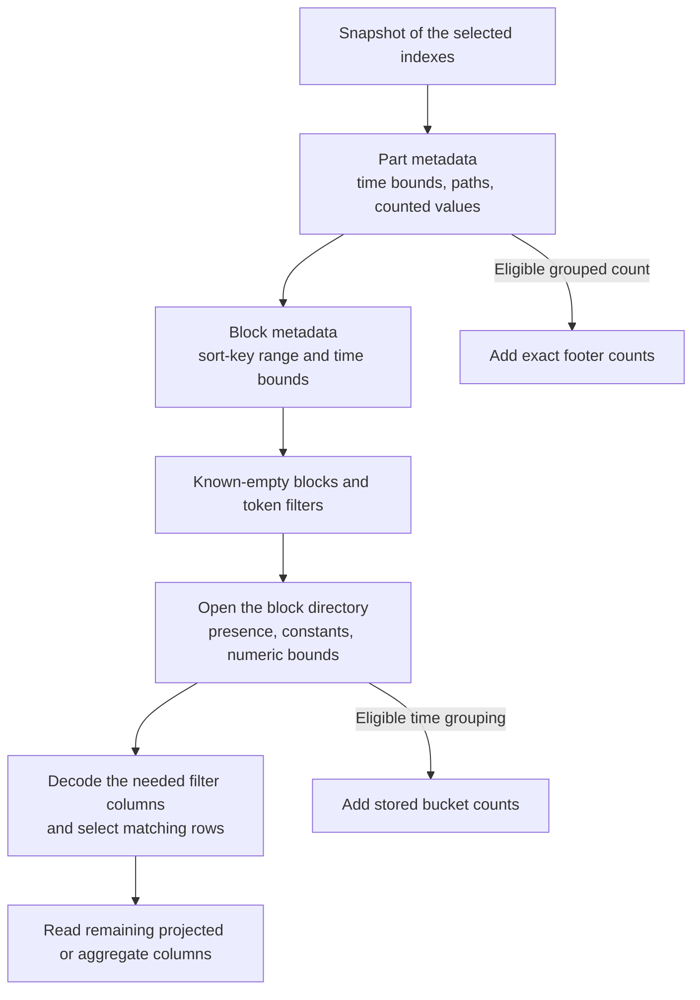
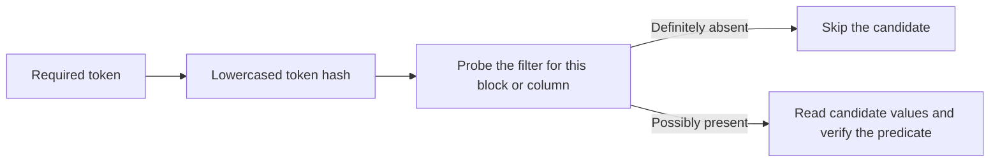

# Indexing and Pruning

A LynxDB index such as `web` is a named store. Inside it, each immutable part carries the metadata used to narrow a scan. A search reads candidate column blocks and verifies matches against the values in those blocks. There is no global term-to-row posting list to update when events arrive or when runs merge.

## From a scan to matching rows

The columnar executor extracts safe shortcuts from the filter where it can. For example, if a row must satisfy two predicates joined by `AND`, either predicate can prove that a block contributes nothing. The executor keeps the actual filter so that the shortcuts and the query return the same result.



This is the general block scan. Some plans use a specialized ordered scan, and a metadata check can settle a predicate without reading its values.

| Structure | Scope | What it can decide |
| --- | --- | --- |
| Event-time minimum and maximum | Part and block | Whether any row can fall within the requested time interval |
| Path dictionary | Part | Whether a required stored path exists |
| First key of each block and sort key definition | Part footer | Which blocks can overlap a leading key prefix or a set of key ranges |
| Exact counts for eligible string paths | Part footer | Whether an exact value exists and how many rows have it |
| Token fingerprint filters | Block, with entries for individual columns or a shared group of columns | Whether the tokens required by a search may occur |
| Counts by time bucket | Part footer, per block | How many rows to add to an eligible grouping by time |
| Column directory and dictionary | Block | Whether the predicate is settled by metadata, and which encoded values or rows pass |
| Cached misses | In memory, per part and condition | Which immutable blocks a previous scan proved empty for that condition |

Queries with a time range first compare it with the part's stored event-time bounds, then with its blocks' bounds. A boundary block can contain rows outside the interval, so the executor still checks row timestamps as needed. Time partitions govern file ownership, merges and retention. The scanner can use its actual time bounds even when the rows inside a part are ordered by another field.

## Sort key pruning

The store records its sort key in each part. For a key of `[service, route]`, rows with the same `service` are adjacent within each run. Within that service, the rows are ordered by `route`, with event time breaking ties. Other runs can cover the same keys.

The engine can use string equality on consecutive leading key fields and a list of string values on the next key field. It binary-searches the first keys of the blocks, keeping a preceding block when it can straddle a range boundary. A list produces several key ranges whose overlapping block spans are joined. Parts with incompatible keys still participate through the general scan.

| Predicate | Usable prefix for `[service, route]` |
| --- | --- |
| `service = "checkout"` | `service` |
| `service = "checkout" AND route = "/pay"` | `service, route` |
| `service = "checkout" AND route IN ("/pay", "/refund")` | Two key ranges within `checkout` |
| `route = "/pay"` | None. The same route can appear under multiple services. |

For some grouped queries the executor can also work in key order. A string equality fixes a leading prefix, and grouping on the following key fields lets the executor combine matching ranges from sorted runs. It checks the plan and the stored key metadata before choosing this path. A group covering a continuous run of one key can take its earliest and latest timestamps from the ends of that run. For eligible distinct counts over several runs, a block inside one group can contribute only its dictionary entries. When the plan or block layout requires it, the executor reads the values and can aggregate with hash tables. See [Sort key configuration](../configuration/storage.md#sort-key).

## Token filters

The writer hashes lowercased tokens from strings. A token is a consecutive run of letters or digits, so `upstream_timeout=504` contributes `upstream`, `timeout` and `504`. Text nested in variant values also contributes tokens. The writer can tokenize distinct dictionary values once when the column uses a dictionary.

Each block can hold separate filters for large encoded string or variant columns and a shared filter for the remaining columns. The dedicated filter threshold is 16 KiB of encoded column data.

A filter divides its distinct token hashes into equal-size cells. The high bits select a cell. Within it, the writer stores reduced hash values in sorted order using an encoding based on Elias and Fano. The probe looks for the reduced value in that one cell. A cell packed beyond its capacity answers “possibly present” for every probe. Each cell stores fingerprints alone, so no probe returns row numbers.

The writer arranges the filters for consecutive blocks in stripes. A token maps to the same stripe across the group, keeping probes for that token near one another in the file. Pages carry their own checksums.



A positive probe may come from two tokens with the same fingerprint. It can also reflect tokens in different rows or, for a shared filter, different columns. For example, a block with `upstream unavailable` in one row and `request timeout` in another can pass a probe for both tokens in `"upstream timeout"`. The phrase test still requires the matching text in a value.

The compiler only probes tokens every match must contain. A prefix or substring may cover part of a longer token. A regex can contribute complete mandatory tokens only when analysis can prove them. A plain search for a number can also match a numeric value, so the engine cannot reject the block on the absence of that token in strings alone. A common token may occur in nearly every block, although dedicated filters can still help the executor avoid searching unrelated columns.

## Column metadata and exact counts

After opening a block directory, the executor can use presence counts, constant values and integer bounds. A predicate such as `status >= 500` can rule out a block whose integer maximum is 499, provided no other compatible type can satisfy it. A constant can settle a predicate for all present rows. Sparse presence still determines which rows actually hold the field.

When the block must be read, a dictionary-backed predicate can evaluate each distinct value once and apply the result to its row codes. Some equality paths look up a dictionary code or match packed strings directly in their encoded chunk. Once the executor identifies matching rows, it can defer reading projection-only columns until it needs them.

Some dictionaries store exact counts by value. A part can also keep exact counts in its footer for a path whose stored values are all strings, when the writer can count every value and the distinct values fit within the format's limits of 256 values and 64 KiB of string bytes per path. Missing rows are tracked separately from the counted values.

The general scan can reject a whole part if a counted path lacks the string required by an equality. If that value occurs often enough, the scan can bypass its token-filter probe for that part and still evaluate the equality. For an eligible `stats count() by level` with no filter beyond time, the executor can add exact footer counts from parts fully inside the requested interval. Parts that straddle the time range or lack usable counts take the normal scan path.

The part also keeps a bounded in-memory map of blocks already found empty for a specific scan condition. This can avoid repeating work on immutable files. It holds no query rows and disappears when the part is closed.

## Counts by time bucket

When the records fit, a part footer stores each block's row counts in UTC minute, hour and day buckets aligned to the Unix epoch. An hourly report can use those counts:

```ppl
source=web | stats count() as n by span(_time, 1h) as hour | sort hour
```

The executor needs a stored bucket width that divides the query's grouping interval. For example, a five-minute grouping can sum minute records. Additional grouping columns must have one value throughout the block or be absent throughout. Other predicates must pass the whole block for it to use the stored counts. When the request time range cuts a stored bucket, the executor can read row times at that boundary and still sum the buckets contained in the range. Ineligible blocks use ordinary row selection over the decoded columns.

## How a query uses the structures

Suppose `web` has a sort key of `[service, route]` and stores integer HTTP status codes. Send the query with a time range covering the incident.

```ppl
source=web "upstream timeout"
| where service = "checkout" AND status >= 500
| fields _time, service, status, message
```

The executor can skip parts and blocks outside the interval and narrow compatible parts to the `checkout` key range. A token-filter probe can rule out blocks missing either required word. In candidate blocks, metadata can settle the numeric predicate. The executor checks the surviving text values and then reads any projected columns that the filter did not already need. For this columnar scan, the unqualified phrase can match a stored string or a string inside a variant. The projection of `message` controls the output. The IR printed by `explain` displays an unqualified search as `SEARCH_PHRASE(_raw, ...)`. The columnar translator treats an unspecified field as a search across eligible values.

## Inspecting a scan

When the standard query endpoint returns a completed columnar result, look at `meta.stats`. The scan reports how many blocks it opened and how many it skipped by time, key, tokens, cached misses and column statistics. `skipped_by_stats` describes rejected blocks whose directories were already open, so it is separate from the checks before opening a block. Free-text searches also report the number of columns searched or skipped by filters.

Three counters report when an aggregation used metadata. `counted_by_index` records blocks aggregated with the part index, `counted_by_entries` counts blocks that also read dictionary entries, and `counted_by_time` counts blocks handled by the time-bucket path. The response can include an ordered aggregation flag or a reason for switching to hash aggregation. The counters describe executor work. An opened block may already be in the operating system's page cache.

## Code entry points

- General block scan and prefix bounds. [pkg/colstore/scan.go](https://github.com/lynxbase/lynxdb/blob/main/pkg/colstore/scan.go), [pkg/colstore/part/key.go](https://github.com/lynxbase/lynxdb/blob/main/pkg/colstore/part/key.go)
- Tokenization and fingerprint cells. [pkg/colstore/tokenfilter](https://github.com/lynxbase/lynxdb/tree/main/pkg/colstore/tokenfilter), [pkg/colstore/part/writer.go](https://github.com/lynxbase/lynxdb/blob/main/pkg/colstore/part/writer.go)
- Translation of search predicates. [pkg/colstore/exec/irplan/irplan.go](https://github.com/lynxbase/lynxdb/blob/main/pkg/colstore/exec/irplan/irplan.go)
- Block predicates and exact counts. [pkg/colstore/exec/filter.go](https://github.com/lynxbase/lynxdb/blob/main/pkg/colstore/exec/filter.go), [pkg/colstore/exec/agg_parts.go](https://github.com/lynxbase/lynxdb/blob/main/pkg/colstore/exec/agg_parts.go)
- Stored time buckets and their use in aggregation. [pkg/colstore/part/timecounts.go](https://github.com/lynxbase/lynxdb/blob/main/pkg/colstore/part/timecounts.go), [pkg/colstore/exec/agg_time.go](https://github.com/lynxbase/lynxdb/blob/main/pkg/colstore/exec/agg_time.go)
