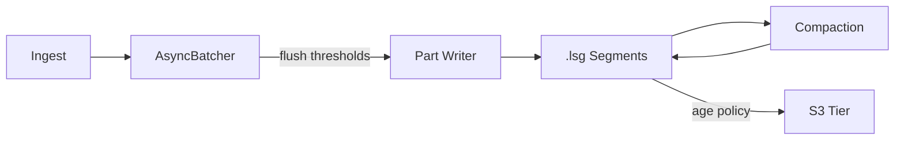
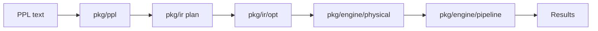

# Architecture Overview

LynxDB is a columnar log analytics database written in Go. The storage engine, query engine, indexes and HTTP API are built for log search and aggregation; there is no embedded third-party database (no RocksDB, no SQLite, no Lucene). Queries are written in OpenSearch Piped Processing Language (PPL). This page maps the system and how its parts fit together.

## System Diagram

```
                          ┌─────────────────────────────┐
                          │         lynxdb CLI          │
                          │  query · ingest · server    │
                          │  status · tail · config     │
                          └──────────────┬──────────────┘
                                         │
                ┌────────────────────────┼────────────────────────┐
                │                        │                        │
         ┌──────┴──────┐         ┌───────┴──────┐        ┌───────┴──────┐
         │  Pipe Mode  │         │  Server Mode │        │ Cluster Mode │
         │ (ephemeral  │         │ (persistent  │        │ (distributed │
         │  in-memory) │         │  single node)│        │  multi-node) │
         └─────────────┘         └──────┬───────┘        └──────┬───────┘
                                        │                       │
            ┌───────────────────────────┼───────────────────────┘
            │
┌───────────┴───────────────────────────────────────────────┐
│                    Storage Engine                          │
│                                                           │
│  ┌──────────────┐  ┌───────────┐  ┌──────────┐            │
│  │ AsyncBatcher │→ │ Part      │→ │  S3 Tier │            │
│  │ (per-index   │  │ Writer    │  │  (warm/  │            │
│  │  buffering)  │  │  (.lsg)   │  │   cold)  │            │
│  └──────────────┘  └─────┬─────┘  └──────────┘            │
│                          │                                │
│  ┌───────────────────────┴────────┐                       │
│  │         Per-segment indexes    │  ┌─────────────────┐  │
│  │  ┌────────┐  ┌──────────────┐  │  │   Compaction    │  │
│  │  │ Bloom  │  │  Term index  │  │  │  L0 → L1 → L2   │  │
│  │  │ filters│  │ (FST+roaring)│  │  │                 │  │
│  │  └────────┘  └──────────────┘  │  └─────────────────┘  │
│  └────────────────────────────────┘                       │
└───────────────────────────────────────────────────────────┘
            │
┌───────────┴───────────────────────────────────────────────┐
│                    Query Engine                            │
│                                                           │
│  ┌─────────┐  ┌────────┐  ┌───────────┐  ┌──────────────┐ │
│  │  PPL    │→ │   IR   │→ │ Optimizer │→ │ Physical plan│ │
│  │ frontend│  │  plan  │  │  (rules)  │  │ + VM bytecode│ │
│  └─────────┘  └────────┘  └───────────┘  └──────┬───────┘ │
│                                                 │         │
│  ┌──────────────────┐  ┌────────────────────────┴───────┐ │
│  │  Result cache    │  │  Pipeline iterators (Volcano)  │ │
│  └──────────────────┘  └────────────────────────────────┘ │
└───────────────────────────────────────────────────────────┘
```

## Three Ways to Run

LynxDB ships as a single static binary that runs in pipe mode or as a server; both share the query engine. `pkg/cluster` holds the components of a third, distributed mode.

### Pipe Mode (Ephemeral, In-Memory)

```bash
cat app.log | lynxdb query 'source=main | where level = "ERROR" | stats count() by service'
lynxdb query --file '/var/log/nginx/*.log' 'source=main status>=500 | top 10 uri'
```

In pipe mode, LynxDB works like `grep` or `awk`. The binary:

1. Creates an ephemeral in-memory engine (no data directory, no files written).
2. Loads stdin or the given files into the index `main`. Combined, syslog and docker log formats are detected and their fields extracted while loading; `key=value` pairs are extracted too. `--raw` turns detection off.
3. Compiles the query and runs it with the same compiler, optimizer and operators as the server.
4. Prints the results and exits.

There is no daemon, no config file and no network I/O.

### Server Mode (Persistent, Single Node)

```bash
lynxdb server --data-dir /var/lib/lynxdb
```

Server mode starts a long-running process that:

1. Opens (or creates) a data directory with part files, caches and metadata, and checks its `FORMAT` marker.
2. Scans the data directory, removes stale temporary files, and rebuilds the in-memory part registry.
3. Starts the HTTP API on port 3100 (configurable).
4. Accepts ingest requests, buffers events in the `AsyncBatcher`, and flushes immutable `.lsg` parts.
5. Runs background compaction (L0 → L1 → L2), retention, and optional S3 tiering.
6. Serves queries over buffered events, local parts and tiered segments.

Optional S3 tiering moves older segments to object storage and keeps them queryable through a local segment cache.

### Cluster Mode (Distributed, Multi-Node)

:::caution Cluster runtime
`lynxdb server` validates the `cluster` section of the configuration, but it does not start the cluster runtime: it opens no gRPC listener, joins no Raft group, and routes no shards. This section describes the cluster components in `pkg/cluster`.
:::

The cluster design uses the same binary with clustering settings. Nodes find each other through seed addresses and take one or more of three roles:

| Role | Responsibility | Scales with |
|------|----------------|-------------|
| **Meta** (3-5 nodes) | Raft consensus, shard map, node registry, leader leases, field catalog, source registry | Cluster size |
| **Ingest** (N nodes) | Batcher writes, part flush, S3 upload, batch replication | Write throughput |
| **Query** (M nodes) | Scatter-gather, partial aggregation merge, segment caching | Query concurrency |

In small clusters (fewer than 10 nodes), every node runs all three roles. S3 is the source of truth for segments. Data is sharded in two levels (time bucket, then `xxhash64` hash partition) and replicated with batch replication and configurable ACK levels.

See [Distributed Architecture](/docs/architecture/distributed) for details.

## Major Subsystems

### Storage Engine

The storage engine handles the data lifecycle: ingest → buffering → part flush → compaction → tiering → retention.



- **AsyncBatcher**: per-index in-memory buffering that flushes on event count, size or idle time.
- **Part writer**: writes `tmp_*.lsg`, optionally `fsync`s, then renames the file into place.
- **Segments**: columnar `.lsg` files, row groups of up to 65536 rows. Timestamps are delta-encoded, strings dictionary- or LZ4-encoded, floats Gorilla-encoded, with LZ4 or ZSTD block compression. Each segment embeds per-row-group bloom filters, column statistics and an FST term index over `_raw`.
- **Compaction**: three levels (L0 overlapping → L1 merged → L2 near the target size of 1 GB), rate-limited.
- **Tiering and retention**: hot (local disk) → warm (S3) → cold (S3 or archive policy); time partitions older than the retention period are deleted.

See [Storage Engine](/docs/architecture/storage-engine) and [Segment Format](/docs/architecture/segment-format).

### Query Engine



- **Frontend** (`pkg/ppl`): lexer, recursive-descent parser, semantic analysis against each command's output schema, and lowering to the IR. Errors carry a code, position and hint.
- **IR** (`pkg/ir`): a language-independent tree of typed logical operators. Everything after the frontend works on the IR only.
- **Optimizer** (`pkg/ir/opt`): rule-based rewrites (constant folding, filter merging, scan pruning predicates, time ranges, top-N, limit pushdown) and column pruning.
- **Planner** (`pkg/planner`): adds the storage hints (search terms, field equality, time bounds, columns) the server uses to skip segments and row groups.
- **Physical planner** (`pkg/engine/physical`): maps IR operators onto pipeline iterators and compiles expressions to bytecode for the VM (`pkg/vm`).
- **Pipeline** (`pkg/engine/pipeline`): pull-based iterators over batches of up to 1024 rows. `head 10` stops reading once it has 10 rows.
- **Result cache** (`pkg/cache`): caches complete query results keyed by query, time range and ingest generation.

See [Query Engine](/docs/architecture/query-engine) and the [PPL architecture](../ppl/architecture.md) pages.

### Indexing

- **Bloom filters**: per row group and string column. A segment whose blooms lack a search token is skipped without reading its columns.
- **Term index**: an FST term dictionary over the tokens of `_raw`, with roaring bitmap posting lists. Answers word, phrase, prefix and glob searches with the matching row numbers.
- **Column statistics**: min/max per segment and row group, constant columns and column presence skip data for string equality predicates.

See [Indexing](/docs/architecture/indexing).

### REST API

The HTTP API (`pkg/api/rest`) exposes:

- **Ingest**: event arrays at `/api/v1/ingest`, raw lines at `/api/v1/ingest/raw`, the Elasticsearch `_bulk` API, OTLP logs, and the Splunk HEC protocol.
- **Query**: synchronous, asynchronous (jobs) and hybrid execution, NDJSON streaming, explain, live tail over SSE, and the PPL catalog at `/api/v1/catalog`.
- **Management**: field catalog, indexes, sources, server status and statistics, cache, configuration, API keys.

See [REST API Overview](/docs/api/overview).

## Data Flow

### Write Path

```
HTTP POST /api/v1/ingest, /api/v1/ingest/raw, /_bulk, /services/collector, or /api/v1/otlp/v1/logs
  → Decode the request (event array, raw lines, or protocol payload)
  → Convert payloads into events
  → Buffer in AsyncBatcher
  → [Flush threshold reached]
    → Write tmp_*.lsg part
    → Optional fsync + atomic rename
    → Register part metadata
  → [Background]
    → Compaction merges L0 → L1 → L2
    → Tiering moves aged segments to S3
    → Retention deletes expired time partitions
```

### Read Path

```
PPL query text
  → Parse, analyze and lower to an IR plan (cached by query text)
  → Optimize (rewrite rules, column pruning)
  → Derive storage hints
  → Result cache lookup
  → Select segments: source scope, time bounds, column min/max, bloom filters
  → Build pipeline iterators; compile expressions to VM bytecode
  → Scan:
    → Events still in the batcher
    → Selected segments, row group by row group:
      → Term index bitmap, row group filters
      → Decode only the required columns
  → Stream through operators (Filter, Compute, Aggregate, TopN, ...)
  → Output (JSON / NDJSON / table / CSV)
```

## Next Steps

- [Storage Engine](/docs/architecture/storage-engine) -- buffering, part flush, compaction, tiering
- [Segment Format](/docs/architecture/segment-format) -- the columnar `.lsg` format
- [Query Engine](/docs/architecture/query-engine) -- compiler, optimizer, physical planning, execution
- [Indexing](/docs/architecture/indexing) -- bloom filters, term index, column statistics
- [Distributed Architecture](/docs/architecture/distributed) -- Raft, sharding, scatter-gather, S3
- [Design Decisions](/docs/architecture/design-decisions) -- why columnar, why PPL, why Go, why a single binary
