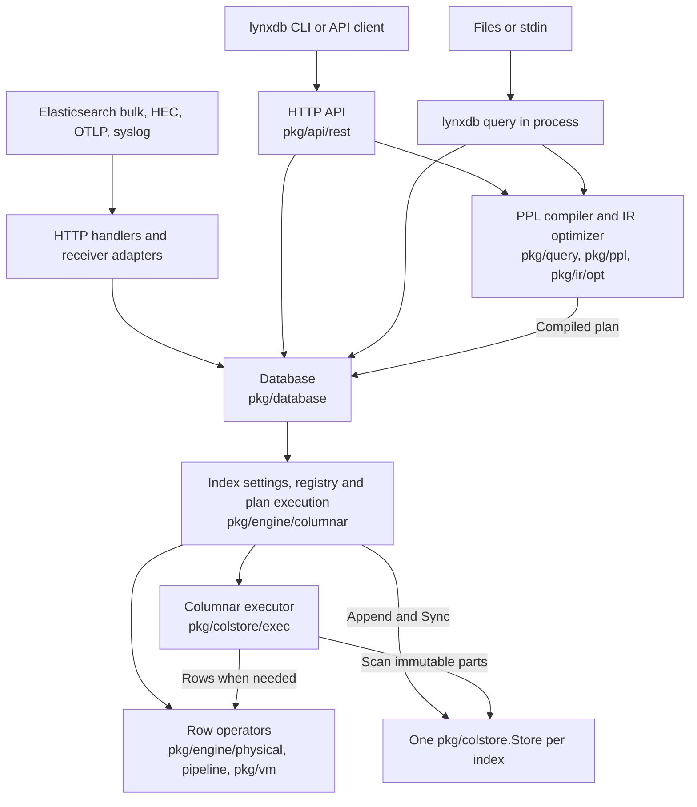
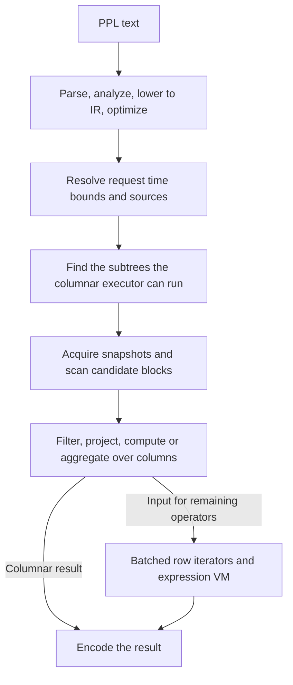

# Architecture Overview

LynxDB is a single-node log analytics database written in Go. The `lynxdb` binary runs queries locally over files or stdin, starts a persistent HTTP server, and acts as a client for that server. Both local and server queries use the same PPL compiler, query executors and disk-backed columnar store.

The database organizes events into named indexes such as `main` or `web`. Each index owns its files, storage settings, buffers and background merges. Queries name indexes with `source=`, and a scan can read more than one index. Within an index, the engine keeps events in immutable columnar parts. The [storage guide](./storage.md) follows a write to disk, and [Indexing and Pruning](./indexing.md) shows how a query skips work inside those files.

## Process and package boundaries {#system-diagram}



| Package | Responsibility |
| --- | --- |
| `cmd/lynxdb`, `pkg/client` | CLI commands, local input and output, HTTP client, server startup |
| `pkg/api/rest`, `pkg/ingest` | Request handling, protocol decoding, ingest conversion, query and job responses |
| `pkg/database` | Default index, query slots and jobs, request time bounds, retention |
| `pkg/ppl`, `pkg/query`, `pkg/ir/opt` | PPL parsing and lowering, optimized plan cache and IR rewrites |
| `pkg/engine/columnar` | Store registry, source resolution, snapshots and selection of an executor for each subtree |
| `pkg/colstore`, `pkg/colstore/exec`, `pkg/vec` | Column storage, block scans, vector operations and columnar aggregation |
| `pkg/engine/physical`, `pkg/engine/pipeline`, `pkg/vm` | Physical row plan, batched iterators and expression bytecode |

See [Project Structure](../contributing/project-structure.md) for the package and test layout.

## Local queries and the server {#two-ways-to-run}

### Files and stdin {#pipe-mode}

```bash
printf '%s\n' '{"level":"ERROR"}' '{"level":"INFO"}' '{"level":"ERROR"}' |
  lynxdb query 'source=main | stats count() as n by level | sort - n'
```

The CLI compiles the query before reading input. It creates a temporary database, converts input to NDJSON, and appends it to `main`. JSON object lines pass through to the store. For text input, the CLI can detect a log format and extract fields before writing. It calls `Sync`, executes the plan in process, prints the result, and removes the temporary directory on close. This path uses part files on disk and requires no running server.

### Server {#server-mode}

```bash
lynxdb server --data-dir /var/lib/lynxdb
```

The server opens existing stores under `data_dir/indexes/` and recovers each store's live part set before serving requests. The default HTTP address is `localhost:3100`. The main listener serves the native API and configured protocol routes. The server also starts separate OTLP HTTP, OTLP gRPC and syslog listeners when configured.

The server process owns the stores, query jobs and retention passes. Run the CLI against the server to ingest and query the same indexes from a different process. Authentication, TLS and listener configuration live at this boundary. The [REST API](../api/overview.md) describes the public request and response formats.

## Write path

| Entry point | What reaches the store |
| --- | --- |
| `POST /api/v1/ingest` | The handler appends whole lines in chunks as the body arrives. The store parses JSON objects and keeps other nonempty lines as text. |
| `POST /api/v1/ingest/raw` | Log text passes through the text converter for timestamp and field extraction. Object lines pass through to the store. |
| Elasticsearch `_bulk` | The handler reads action and document lines, groups supported writes by target index and appends the documents. |
| Splunk HEC and OTLP | The receivers map payloads to events and run them through the ingest pipeline. Both write to `main`. HEC can use the sender's index name as event metadata. |
| Syslog | The receiver parses the message and runs it through the ingest pipeline before writing to `syslog.index` (`main` by default). |

These paths converge on the same per-index append buffers. A native request can leave an appended prefix if a later chunk fails. The store parses each JSON object into typed columns, chooses the event time, and assigns the row to a time partition when it flushes. A flush sorts the rows, writes parts, and publishes them after a manifest commit. The server can create an index with its own sort key, time fields and partition width before the first ingest. Native ingest can acknowledge buffered data. Successful Elasticsearch bulk items and HEC indexer acknowledgements wait for [sync](./storage.md#acknowledgements-and-visibility).

## Read path



`query.Compile` is shared by the server, local queries and explain. The cache holds compiled plans by query text. Source resolution, the clock for relative times and the contents of stores belong to execution. The request's `from` and `to` bounds intersect the query's time range as a half-open interval `[from, to)`.

Before it runs a plan, the engine syncs the stores of the indexes the plan reads, so that a query sees the events appended before it; if a sync fails, the query reads what is on disk and its result carries a warning. The synchronous, asynchronous and hybrid responses differ in how long the request waits for that job. A call to `/api/v1/query/stream` uses the request context directly and writes the completed result as NDJSON. The HTTP response format and the engine's internal block-by-block handoff are separate parts of the read path.

At execution time, the engine takes a snapshot of each store a scan needs. It resolves literal and wildcard source names and can combine several snapshots for one scan. A snapshot pins a store's parts while they are read. Each store publishes its own versions, so the combination is assembled from per-store snapshots.

The columnar planner attempts to run each supported subtree from a scan upward. For example, predicate evaluation and aggregation can stay in columns, while a join above those scans runs as a row operator. Simple columnar scans can hand batches to row operators as they read them. Other subtrees complete first, for example when their output needs a final aggregation or sort. See [Query Engine](./query-engine.md) for the plan split and [Indexing and Pruning](./indexing.md) for the block scan.

## Code entry points

- Server setup and protocol routing. [pkg/api/rest/server.go](https://github.com/lynxbase/lynxdb/blob/main/pkg/api/rest/server.go)
- Database configuration, query entry points and retention. [pkg/database/database.go](https://github.com/lynxbase/lynxdb/blob/main/pkg/database/database.go)
- Compilation and the executor handoff. [pkg/query/query.go](https://github.com/lynxbase/lynxdb/blob/main/pkg/query/query.go), [pkg/engine/columnar/columnar.go](https://github.com/lynxbase/lynxdb/blob/main/pkg/engine/columnar/columnar.go)
