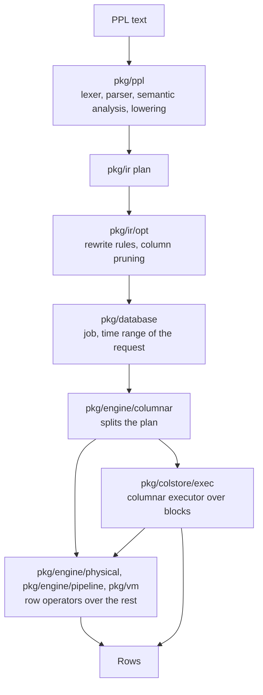

# Query Engine

LynxDB compiles OpenSearch Piped Processing Language (PPL) into a language-independent intermediate representation (IR) and optimizes the plan. Two executors run it: the **columnar executor** runs every part of the plan it can, straight over the column blocks of the stores, and the **row operators** run the rest over rows. This page follows a query through those stages. The PPL pages cover the compiler in detail: [architecture](../ppl/architecture.md), [compilation](../ppl/compilation.md), [IR](../ppl/ir.md) and [optimizer](../ppl/optimizer.md).

## Query Path



| Stage | Package | Output |
|-------|---------|--------|
| Lexing and parsing | `pkg/ppl/lexer`, `pkg/ppl/parser`, `pkg/ppl/ast` | Syntax tree with source positions |
| Semantic analysis and lowering | `pkg/ppl` | Validated IR plan |
| Optimization | `pkg/ir/opt` | Equivalent, cheaper IR plan and the rules that fired |
| Running | `pkg/database`, `pkg/engine/columnar` | The plan split between the two executors |
| Columnar execution | `pkg/colstore/exec`, `pkg/colstore/exec/irplan` | Columns of result rows |
| Row execution | `pkg/engine/physical`, `pkg/engine/pipeline`, `pkg/vm` | Batches of rows |

## Compilation

`query.Compile` in `pkg/query` is the single entry point that turns query text into a plan. The server, pipe mode and `explain` all call it. It runs the frontend, the optimizer and `ir.Validate` over the optimized plan.

Compiling depends only on the query text: relative times stay symbolic until the query runs, and the fields of an index are discovered when rows are read. `pkg/query` therefore keeps the plans of the 1024 most recent queries of up to 2 KiB, and hands each caller its own copy of the immutable plan.

### Frontend: PPL to IR

1. **Lexer** (`pkg/ppl/lexer`): tokens with line and column.
2. **Parser** (`pkg/ppl/parser`): a hand-written recursive-descent parser that builds the syntax tree (`pkg/ppl/ast`). It reports the first syntax error with its position and the expected tokens, and refuses queries over 256 KiB, nesting deeper than 256 levels and pipelines of more than 1000 commands.
3. **Semantic analysis**: every field reference is resolved against the schema the previous command produces. Index scans have open schemas (any field may exist); `stats`, `fields`, `top` and similar commands produce closed schemas, where an unknown field is a `SEMANTIC_ERROR` that lists the available fields. Functions resolve through the PPL catalogs onto the IR function registry, and static types are checked.
4. **Lowering**: each command becomes IR operators. Search terms in the source command become a `Filter`; `eval` becomes `Compute`; `stats` becomes `Aggregate`; `sort ... | head` becomes `Sort` and `Limit`.

A command, function or option that the catalogs mark unsupported fails with `UNSUPPORTED_COMMAND`, `UNSUPPORTED_FUNCTION` or `UNSUPPORTED_FEATURE`, and so does a correlated subquery. See [PPL compilation](../ppl/compilation.md) and [PPL errors](../ppl/errors.md).

### IR

The IR in `pkg/ir` is a tree of logical operators, each with typed expressions and an output schema, and knows nothing about PPL syntax. Its operators are `Scan`, `Values`, `Empty`, `SourceSchema`, `Filter`, `Compute`, `Project`, `RenameColumns`, `Aggregate`, `Window`, `Sort`, `TopN`, `Limit`, `Reverse`, `Dedup`, `Join`, `Union`, `ZipColumns`, `Extract`, `Patterns`, `Unnest`, `FlattenObject`, `FillNull`, `Transpose`, `Totals` and `CombineValues`.

A `Scan` carries, besides its sources, what the optimizer learns about the rows it must produce: a time range, pruning predicates, the columns read and a row limit. See [PPL IR](../ppl/ir.md).

### Optimizer

`pkg/ir/opt` applies rewrite rules over the plan until no rule fires (at most 8 passes), then runs column pruning once. Every rule preserves the result: rules that hand predicates to a scan keep them in the `Filter` above it, so an executor may use any subset of them.

| Rule | Rewrite |
|------|---------|
| `fold-constants` | Evaluates deterministic expressions over literals with the VM: `status >= 400 + 100` becomes `status >= 500` |
| `merge-filters` | Merges adjacent `Filter` operators into one conjunction |
| `remove-true-filter` | Drops a `Filter` whose condition is the literal `true` |
| `prune-scan` | Copies the conjuncts of a `Filter` directly above a `Scan` that can skip data into the scan's pruning predicates |
| `time-range-to-scan` | Narrows the scan's time range with comparisons of `_time` against constant times in the `Filter` above it |
| `sort-limit-to-topn` | Replaces `Limit` over `Sort` with `TopN` |
| `limit-into-scan` | Tells a scan how many rows the plan reads when only `Compute`, `Project` or `RenameColumns` separate a `Limit` from it |
| column pruning | Records on each scan the columns the plan above it reads |

For example:

```bash
lynxdb query --explain 'source=main | where _time >= timestamp("2026-02-10 09:00:00") | where status >= 400 + 100 | eval kb = duration_ms / 1024 | head 5'
```

```
Logical plan:
Limit(5)
└─ Compute(kb = duration_ms / 1024)
   └─ Filter(status >= (400 + 100))
      └─ Filter(_time >= timestamp("2026-02-10 09:00:00"))
         └─ Scan(main)

Optimized plan:
Limit(5)
└─ Compute(kb = duration_ms / 1024)
   └─ Filter((_time >= timestamp("2026-02-10T09:00:00Z")) AND (status >= 500))
      └─ Scan(main) time=[2026-02-10T09:00:00Z, +inf)

Optimizer rules:
  fold-constants x2
  merge-filters x1
  time-range-to-scan x1
```

`lynxdb query --explain` prints both plans and the rules locally; `lynxdb explain` and `GET /api/v1/query/explain` ask the server. See [PPL optimizer](../ppl/optimizer.md) for each rule's conditions.

## Running a Query

The standard HTTP query endpoint syncs the open stores and submits a job to `pkg/database`. The [Query API](../api/query.md) describes how synchronous, asynchronous and hybrid requests wait for that job. The NDJSON endpoint syncs and calls `DB.Query` in the request context, then writes the result. Both execution paths use the `query.max_concurrent` slots and return `429 TOO_MANY_REQUESTS` when all slots are occupied.

The database intersects each scan's time range, including scans in subqueries, with the request's `[from, to)` interval. It then passes the plan to `pkg/engine/columnar`.

### 1. Subqueries as lists of values

A test for membership among the rows of a subquery (`where x in [ ... ]`) whose subquery gives one column of at most 1024 scalar values runs first, and the test becomes a test against that list. The columnar executor can then take the filter. Other subqueries are left to the row operators, which run each uncorrelated subquery once, before the operators that use it.

### 2. The columnar executor

`pkg/engine/columnar` walks the plan from the root down. For each subtree that ends in a scan, it asks `pkg/colstore/exec/irplan` to plan the subtree onto the columnar executor. The planner takes:

- a scan with filters and computed columns,
- one aggregate, with a filter and computed columns above it,
- a choice of columns or of whole events,
- a sort, a limit, and the first row of each key.

It refuses anything else, and the walk goes on below. The largest subtree it takes from each scan up runs on the columnar executor (`pkg/colstore/exec`) over a snapshot of the stores the scan names:

- A scan combines snapshots from the indexes it names. Each snapshot pins the parts of its store until the reader releases it.
- Scan workers take candidate blocks in parallel. The default worker count is bounded by the available CPUs and is shared among concurrent columnar executions. See [Indexing and Pruning](./indexing.md) for the metadata checks and specialized scans.
- Filters and expressions run over the block's columns. A dictionary column is tested once per dictionary entry; a constant column once per block.
- Aggregates keep the state of each group in a row of 64-bit words, with sketches and sets beside it for the aggregates that need them; the workers' states are merged at the end.
- A sort by `_time` with a limit takes the blocks in time order and skips those whose times keep them out of the result.

A subtree that only selects columns of the events it scans hands its rows to the operators above it block by block, as it reads them. The executor computes a function it has no kernel of its own for with the expression compiled for the VM, once per distinct argument.

When the executor takes the whole plan, its columns are the result and no row is built until the rows are written out.

### 3. The row operators

Every part of the plan the columnar executor did not take runs on the row operators. `pkg/engine/physical` maps each IR operator onto pipeline iterators and compiles every expression into a VM program; their input is the rows of the subtrees the columnar executor ran, or the events of a scan it did not take.

| IR operator | Iterator |
|-------------|----------|
| `Scan` | Rows from the columnar executor |
| `Filter` | Runs a boolean VM program per row |
| `Compute` | Runs one VM program per assignment |
| `Project`, `RenameColumns` | Column selection and renaming |
| `Aggregate` | Hash aggregation |
| `Sort` | Sort of up to 10,000,000 rows; a larger input fails the query |
| `TopN` | Bounded heap of N (+ offset) rows |
| `Limit` | Offset and limit; stops pulling from its input when done |
| `Window` | `eventstats`, `streamstats` and `trendline` |
| `Dedup`, `Reverse`, `FillNull` | Dedicated iterators |
| `Join` | Hash join; the right side is held in memory |
| `Union` | Concatenation, or for `multisearch` all rows sorted by time, latest first |
| `Extract`, `Patterns`, `Unnest`, `FlattenObject` | Row-mapping iterators for `parse`/`grok`/`rex`, `patterns`, `expand`, `flatten` |
| `Transpose`, `Totals`, `CombineValues`, `ZipColumns` | Iterators that collect their input first |
| `SourceSchema` | Rows describing the fields of an index (`describe`) |

`pkg/engine/pipeline` uses the Volcano model: each iterator's `Next()` pulls the next batch of up to 1024 rows from its input. `head 10` stops pulling once it has 10 rows. A subquery's columns must be known before execution, so it ends with `fields` or `stats`.

### Bytecode VM

`pkg/vm` evaluates the expressions of the row operators: filter conditions, `eval` assignments, aggregation arguments, sort and join keys. `vm.CompileExpr` compiles an IR expression into a program of one-byte opcodes with a constant pool, run on a fixed stack of values, so evaluating a row allocates no stack. The optimizer's constant folding uses the same VM, so a folded constant has exactly the value the expression has at run time.

## Results

In JSON event results, specified columns appear in plan order and other fields appear in name order. Times use RFC 3339 in UTC. An absent stored field is omitted. The standard query endpoint returns up to `limit` rows starting at `offset` and sets `has_more` if more rows follow. The server uses `query.default_result_limit` when the request omits the limit and caps it at `query.max_result_limit`.

For a completed columnar result returned by the standard query endpoint, `meta.stats` reports scan and aggregation counters. See [Inspecting a scan](./indexing.md#inspecting-a-scan).

## Related

- [Architecture Overview](./overview.md) -- system-level view
- [Storage](./storage.md)
- [Indexing and Pruning](./indexing.md)
- [PPL architecture](../ppl/architecture.md) -- the compiler in detail
- [PPL performance](../ppl/performance.md) -- writing queries that the columnar executor takes
