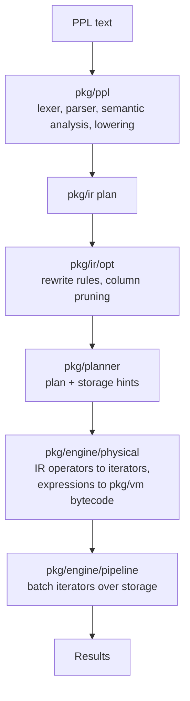

# Query Engine

LynxDB compiles OpenSearch Piped Processing Language (PPL) into a language-independent intermediate representation (IR), optimizes the IR plan, and turns it into a tree of pull-based iterators that read from the storage engine. This page follows a query through those stages and through the server around them. The PPL pages cover the compiler in detail: [architecture](../ppl/architecture.md), [compilation](../ppl/compilation.md), [IR](../ppl/ir.md), [optimizer](../ppl/optimizer.md) and [performance](../ppl/performance.md).

## Query Path



| Stage | Package | Output |
|-------|---------|--------|
| Lexing and parsing | `pkg/ppl/lexer`, `pkg/ppl/parser`, `pkg/ppl/ast` | Syntax tree with source spans |
| Semantic analysis and lowering | `pkg/ppl` | Validated IR plan |
| Optimization | `pkg/ir/opt` | Equivalent, cheaper IR plan and the list of rules that fired |
| Planning | `pkg/planner`, `pkg/engine/physical/hints.go` | Plan plus storage hints for segment selection |
| Physical planning | `pkg/engine/physical`, `pkg/vm` | Iterator tree with compiled bytecode programs |
| Execution | `pkg/engine/pipeline` | Batches of rows |

`pkg/query` is the single entry point that compiles query text. `query.Compile` runs the frontend and the optimizer and validates the optimized plan. Everything that runs a query goes through `query.Compile`:

- **Server**: `pkg/planner` compiles with `query.Compile`, adds storage hints, and the server builds the plan over its segment store.

Compiling depends only on the query text: relative times stay symbolic until execution, and source schemas are discovered when rows are read. `pkg/query` therefore caches compiled plans by text (up to 1024 plans, for queries up to 2 KiB) and hands each caller its own copy of the immutable plan.

## Frontend: PPL to IR

`pkg/ppl` turns PPL text into an IR plan:

1. **Lexer** (`pkg/ppl/lexer`): tokens with line and column. Identifiers may contain `-` and `*`, as in the official PPL grammar, so `a-b` is one identifier.
2. **Parser** (`pkg/ppl/parser`): a hand-written recursive-descent parser that builds the syntax tree (`pkg/ppl/ast`). It reports the first syntax error with its position and the expected tokens, and rejects queries over 256 KiB, nesting deeper than 256 levels and pipelines over 1000 commands.
3. **Semantic analysis**: every field reference is resolved against the schema the previous command produces. Index scans have open schemas (any field may exist); `stats`, `fields`, `top` and similar commands produce closed schemas, where an unknown field is a `SEMANTIC_ERROR` that lists the available fields. Functions resolve through the PPL catalogs (`pkg/ppl/functions.go`, `pkg/ppl/aggs.go`) onto the IR function registry, and static types are checked.
4. **Lowering**: each command becomes IR operators. Search terms in the source command become a `Filter` over `_raw` and field comparisons; `eval` becomes `Compute`; `stats` becomes `Aggregate`; `sort ... | head` becomes `Sort` and `Limit`.

Commands the catalog marks unsupported fail with `UNSUPPORTED_COMMAND`, `UNSUPPORTED_FUNCTION` or `UNSUPPORTED_FEATURE`. See [PPL compilation](../ppl/compilation.md) and [PPL errors](../ppl/errors.md).

## IR

The IR in `pkg/ir` is a tree of logical operators, each with typed expressions and an output schema, and knows nothing about PPL syntax. Its operators are `Scan`, `Values`, `Empty`, `SourceSchema`, `Filter`, `Compute`, `Project`, `RenameColumns`, `Aggregate`, `Window`, `Sort`, `TopN`, `Limit`, `Reverse`, `Dedup`, `Join`, `Union`, `ZipColumns`, `Extract`, `Patterns`, `Unnest`, `FlattenObject`, `FillNull`, `Transpose`, `Totals` and `CombineValues`. `ir.Validate` checks every plan the frontend and the optimizer produce.

A `Scan` carries, besides its sources, everything the optimizer learns about the rows it must produce: a time range, pruning predicates, the columns read, a row limit and a scan direction. See [PPL IR](../ppl/ir.md).

## Optimizer

`pkg/ir/opt` applies rewrite rules bottom-up over the plan until no rule fires (at most 8 passes), then runs column pruning once. Every rule preserves the result. Rules that hand predicates to a scan keep them in the `Filter` above it, so a storage engine may use any subset of them.

| Rule | Rewrite |
|------|---------|
| `fold-constants` | Evaluates deterministic expressions over literals with the VM: `status >= 400 + 100` becomes `status >= 500` |
| `merge-filters` | Merges adjacent `Filter` operators into one conjunction |
| `remove-true-filter` | Drops a `Filter` whose condition is the literal `true` |
| `prune-scan` | Copies the indexable conjuncts of a `Filter` directly above a `Scan` into the scan's pruning predicates: raw-text word, phrase, prefix and glob searches, disjunctions of words, and a column equal to a string literal |
| `time-range-to-scan` | Narrows the scan's time range with comparisons of `_time` against constant timestamps in the `Filter` above it |
| `sort-limit-to-topn` | Replaces `Limit` over `Sort` with `TopN`, a bounded heap |
| `limit-into-scan` | Tells a scan how many rows the plan reads when only `Compute`, `Project` or `RenameColumns` separate a `Limit` from it |
| column pruning | Records on each scan the columns the plan above it reads |

For example:

```
source=main | where _time >= timestamp('2025-01-15 08:00:00') | where status >= 400 + 100 | eval kb = bytes / 1024 | head 5
```

```
Logical plan:
Limit(5)
└─ Compute(kb = bytes / 1024)
   └─ Filter(status >= (400 + 100))
      └─ Filter(_time >= timestamp("2025-01-15 08:00:00"))
         └─ Scan(main)

Optimized plan:
Limit(5)
└─ Compute(kb = bytes / 1024)
   └─ Filter((_time >= timestamp("2025-01-15T08:00:00Z")) AND (status >= 500))
      └─ Scan(main) time=[2025-01-15T08:00:00Z, +inf)

Optimizer rules:
  fold-constants x2
  merge-filters x1
  time-range-to-scan x1
```

`lynxdb query --explain` prints both plans and the rules locally; `lynxdb explain` and `GET /api/v1/query/explain` ask the server. See [PPL optimizer](../ppl/optimizer.md) for each rule's conditions.

## Planner and Storage Hints

On the server, `pkg/planner` wraps compilation. `Plan` returns:

- the compiled and optimized plan and the applied rules
- **storage hints** (`model.QueryHints`) from `physical.PlanHints` in `pkg/engine/physical/hints.go`
- the request's `from`/`to` bounds, parsed separately and intersected with the plan's time range at execution
- `SkipResultCache` when the result depends on the time of execution: relative time bounds, `now()` or another non-deterministic function

`physical.ScanHints` translates one `Scan` into hints:

| Scan property | Hint | Used for |
|---------------|------|----------|
| Sources | Source scope (single index, list, glob, all) | Selecting segments of the queried indexes |
| Time range, resolved against the current time | `TimeBounds` | Skipping segments and row groups by time |
| Word and phrase searches | `SearchTerms`, tokenized to lower-case letter and digit runs | Bloom filters and term index lookups |
| Disjunctions of single-word searches | `SearchTermTree` (`AND` of `OR` groups) | Term index lookups |
| Prefix and glob searches | `TokenGlobs` | Term dictionary (FST) expansion; never bloom filters |
| Column equal to a string literal | `FieldPredicates` with `=` | Column min/max skipping, per-row-group filters, row filtering during the read |
| Columns read | `RequiredCols` | Reading only those columns |
| Row limit, direction | `Limit`, `ReverseScan` | Stopping the scan early |

A plan with one scan gets all of its hints. A plan with several scans (`join`, `append`, `multisearch`, subsearches) keeps only the union of their sources and time ranges, because each data-skipping hint belongs to one scan.

## Server Execution

`pkg/server` runs a planned query in these steps:

1. **Result cache**: the cache key is the query hash, the ingest generation (a counter that changes on every ingest) and the effective time range. A hit returns the cached rows; queries with `SkipResultCache`, or with request `from`/`to`, bypass the cache.
2. **Segment selection**: the server pins the current set of segments so compaction cannot unmap them during the query, orders them newest first, and drops segments outside the source scope or time bounds, segments whose column min/max excludes a string equality predicate, and segments whose bloom filter lacks a search term.
3. **Scan source**: the physical planner's `Source` hook opens a `SegmentStreamIterator` for each `Scan`. It reads events still in the ingest batcher first, then the selected segments one row group at a time, applying the term index, per-row-group filters and the required columns. Only one row group's events are in memory at a time.
4. **Physical planning**: `physical.Build` turns the plan into iterators with a per-query memory coordinator and the server's spill manager.
5. **Collection**: the root iterator is drained into result rows. Event queries without a `head` are capped at `query.max_result_limit` rows.

## Physical Planning

`pkg/engine/physical` maps each IR operator onto one or more pipeline iterators and compiles every IR expression into a VM program:

| IR operator | Iterator |
|-------------|----------|
| `Scan` | Storage source from the `Source` hook, plus a time filter that enforces the scan's time range exactly |
| `Filter` | Filter iterator running a boolean VM program per row |
| `Compute` | Eval iterator running one VM program per assignment |
| `Project`, `RenameColumns` | Column selection and renaming |
| `Aggregate` | Hash aggregation; spills partial state to disk under memory pressure |
| `Sort` | Sort; spills sorted runs to disk under memory pressure |
| `TopN` | Bounded heap of N (+ offset) rows |
| `Limit` | Offset and limit iterators that stop pulling from their input when done |
| `Window` | `eventstats`, `streamstats` and `trendline` iterators |
| `Dedup`, `Reverse`, `FillNull` | Dedicated iterators |
| `Join` | Hash join; the right side is held in memory |
| `Union` | Concatenation, or a newest-first merge for `multisearch` |
| `Extract`, `Patterns`, `Unnest`, `FlattenObject` | Row-mapping iterators for `parse`/`grok`/`rex`, `patterns`, `expand`, `flatten` |
| `Transpose`, `Totals`, `CombineValues`, `ZipColumns` | Iterators that collect their input first |
| `SourceSchema` | Rows describing the fields of an index (`describe`) |

Uncorrelated subqueries (`where x in [ ... ]`, `exists`, scalar subsearches) run once while the plan is built, and their rows become constants of the VM programs that use them. A subquery's columns must be known before execution, so it ends with `fields` or `stats`.

Operators that hold rows register a memory account with the per-query coordinator. Aggregation and sort spill to disk when their share runs out; the others fail the query with `QUERY_MEMORY_EXCEEDED`.

## Pipeline Execution

`pkg/engine/pipeline` uses the Volcano model: each iterator's `Next()` pulls the next batch from its input. Batches hold up to 1024 rows.

```
Output
  ↑ Next()
TopN(10)
  ↑ Next()
Aggregate(count() BY path)
  ↑ Next()
Filter(status >= 500)
  ↑ Next()
Scan (buffered events, then segments row group by row group)
```

- **Early stop**: `head 10` stops pulling once it has 10 rows, so the scan reads no further segments.
- **Bounded memory for streaming operators**: filters, evals and projections hold one batch at a time. Blocking operators (aggregation, sort, joins, `eventstats`) hold their state under the memory coordinator.
- **Statistics**: each iterator records rows in and out and time spent; `--analyze` and the `profile` request field report them.

## Bytecode VM

`pkg/vm` evaluates every expression: filter conditions, `eval` assignments, aggregation arguments, sort keys and join keys. `vm.CompileExpr` compiles an IR expression into a program of one-byte opcodes with a constant pool. The VM runs on a fixed 256-slot stack of values, so evaluating a row allocates no stack. Every function in the IR registry has a native Go implementation in `pkg/vm`. The optimizer's constant folding uses the same VM, so a folded constant has exactly the value the expression has at run time.

`where status >= 500` compiles to four instructions: `OpLoadPath` pushes the row's `status` value, a constant instruction pushes `500` from the constant pool, `OpGteStrict` compares them with null-aware semantics (a missing or null operand yields null, which a filter treats as false), and `OpReturn` ends the program. `AND`, `OR` and `NOT` compile to three-valued opcodes and conditional jumps, so the right side of `AND` runs only when the left side does not decide the result.

## Live Tail

`GET /api/v1/tail` and `lynxdb tail` compile the query with the same planner, then reject plans containing an operator that needs all of its input before producing output (`Aggregate`, `Sort`, `TopN`, `Window`, `Reverse`, `Transpose`, `Totals`, `Join`, `Union`, `ZipColumns`, `CombineValues`, `Patterns`, `SourceSchema`) with `422`. Filters, `eval`, `fields`, `rename`, extraction commands, `dedup` and `head` run over the live event stream.

## Related

- [Architecture Overview](/docs/architecture/overview) -- system-level view
- [PPL architecture](../ppl/architecture.md) -- the compiler in detail
- [PPL performance](../ppl/performance.md) -- writing queries that use the plan rewrites
