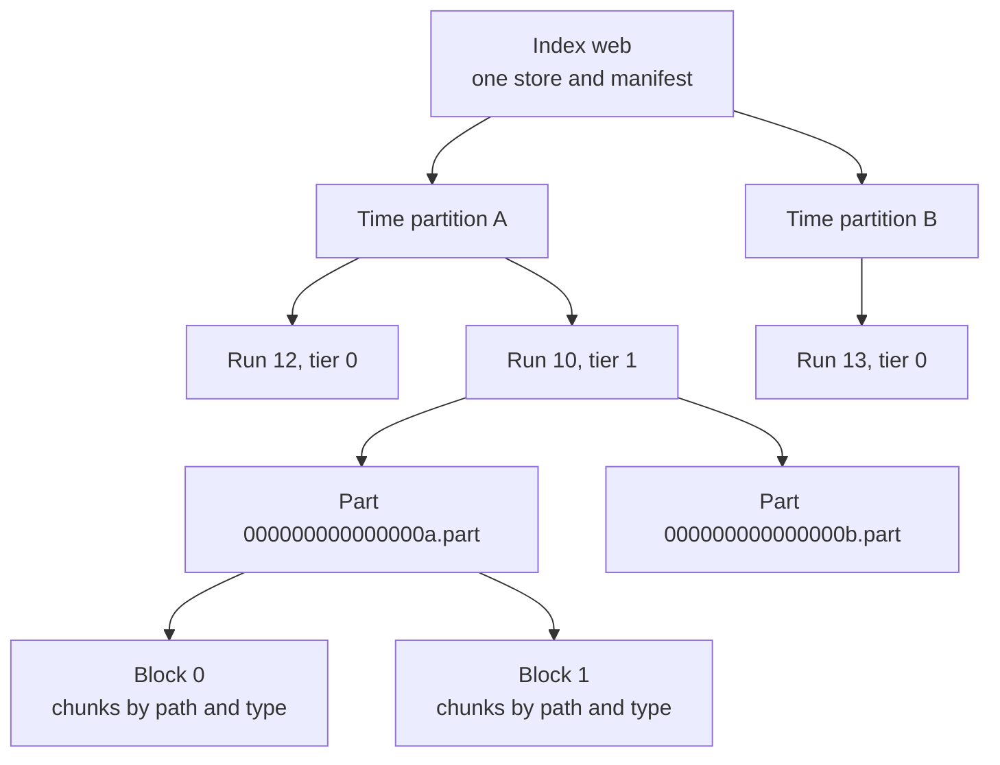
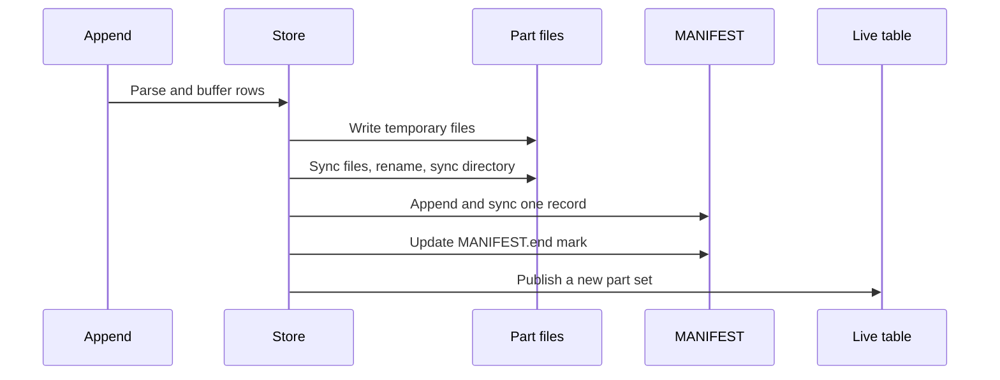

# Storage

Each LynxDB index is a local columnar store. Incoming rows stay in memory until a flush writes them to immutable part files. The manifest commits the new files as a group, then the store publishes them to readers. Compaction and retention use the same commit mechanism to replace or remove files.

## The data directory

```text
<data_dir>/
  lynxdb.pid
  auth/                         # if API keys are configured
  tls/                          # if the server generates its certificate
  indexes/
    main/
      settings.json
      MANIFEST
      MANIFEST.end
      0000000000000000.part
      0000000000000001.part
    web/
      settings.json
      MANIFEST
      MANIFEST.end
      0000000000000000.part
      lost+found/               # if recovery set aside any files
```

| File | Contents |
| --- | --- |
| `<index>/settings.json` | The index's sort key, timestamp field list and partition width. The server reads this file each time it opens the index. |
| `<index>/MANIFEST` | Checksummed records of the live part set. Each addition includes the file name, run ID, tier and partition number. |
| `<index>/MANIFEST.end` | Checksummed marks for the recorded manifest length, identified by the first record's checksum. |
| `<index>/*.part` | Immutable files containing column data and scan metadata. File IDs are local to the index. |
| `<index>/*.part.tmp` | Files under construction. Publication gives them their final `.part` name. |
| `<index>/lost+found/` | Finished part files set aside by [recovery](#recovery). |

An index can be created explicitly with `PUT /api/v1/indexes/{index}`. The first append to a new index creates it with the server's defaults. Its name uses ASCII letters, digits, dots, hyphens and underscores, with a maximum of 255 bytes and no leading dot. Native ingest and the index creation endpoint return `400 VALIDATION_ERROR` for invalid names. The default index is `main`.

The engine fills omitted settings from the server configuration and writes the resolved settings to a temporary directory named `.<index>.new`. It syncs the file and directory, renames the directory into place and syncs the indexes directory. Startup removes staging directories left by interrupted creations. The server opens each index with its saved settings.

The index settings stay fixed after creation. Repeating the creation request with compatible settings returns the existing index. A request specifying a different setting returns `409 CONFLICT`. Changing the server defaults affects new indexes. See [Storage Settings](../configuration/storage.md) and the [index creation API](../api/ingest.md#put-indexesindex).

A server with an empty `data_dir` uses a temporary directory for the stores. Local queries over files or stdin also use temporary stores. The database removes that directory when it closes normally.

## From events to rows

The store takes one object per NDJSON line. It skips empty lines. A line that cannot be parsed as a JSON object becomes a text row with `_raw` in the server's store configuration. Valid object lines keep their fields, including an explicit `_raw` if the sender provided one. The store creates no raw copy of a parsed object.

The JSON parser writes directly into typed column builders. A nested member such as `{"http":{"status":503}}` becomes the path `http.status`. One path can have separate integer, float, string, boolean and null columns in the same block. Presence information distinguishes an omitted field from an explicit JSON null. Arrays and some nested or empty objects use the binary variant format. When the shredding batch runs out of space for new paths, it retains the extra members in a variant object at `_rest`.

Every row also has a canonical event timestamp. The store tries the index's `time_fields` in order, using the first usable value. The server default is `[_time, timestamp, "@timestamp", time, ts]`. Epoch numbers are interpreted as seconds, milliseconds, microseconds or nanoseconds according to magnitude. Calendar timestamps without a zone are read in UTC. If no candidate parses, the store uses the append time. Queries expose the canonical timestamp as `_time`, with the other input time fields still available by path.

## Partitions, runs, parts and blocks {#time-partitions}



This hierarchy is logical. The part files for all partitions and runs of an index sit in the same directory.

- A **partition** is a fixed-width interval of event time aligned to the Unix epoch. With the default `storage.partition: 24h`, partitions are UTC days. A merge stays within one partition, and a retention pass drops whole partitions.
- A **run** is one sorted sequence of rows in a partition. Each flush writes one run per partition represented in its buffers. Fresh runs start at tier 0.
- A **part** is one file covering a range of the run's order. Different runs of the same partition can overlap in time and sort key.
- A **block** is the unit of a scan within a part. It holds up to 16,384 rows with the server defaults.

An empty sort key orders rows within a run by event time. With `[service, route]`, the store orders by those fields and uses time to break ties. Each part records its key for the scan planner. A scan over multiple indexes can encounter parts with different sort keys. See [Sort key pruning](./indexing.md#sort-key-pruning).

The manifest records a partition by its integer number. The index's saved partition width determines the start and end of that partition, including when retention decides to remove it.

## Flush and commit {#writes-buffers-runs-and-sync}

Concurrent appends fill several in-memory batches in a store. The flusher takes those batches when one has waited long enough, when the total buffered input reaches its budget, or when a caller requests a sync. The default flush interval is one second. It is an age threshold checked by a periodic loop. Writes still take time after that threshold, and a failed write can delay publication further.

During a flush, the store sorts each batch by partition and key. It samples keys to cut large runs into files and merges the sorted ranges from different batches into output blocks. The database uses its fastest compression level for these initial writes.

Each store can have two flushes writing at once. Ingest can refill the buffers while they work, until it needs to wait for room. The store tracks which batches each flush took. A sync waits for the earlier flushes that cover its writes as well as the one it requests. When a flush fails, the store holds its batches for retry and reports errors to callers waiting for a flush or for room as applicable.



The manifest record is the durability boundary. The live table changes after the record is synced. All runs produced by one append-buffer flush in a store are published together. A database-wide `Sync` visits the open stores individually. Sync callers for the same store can share a flush, and a store with no pending writes can return immediately.

### Acknowledgements and visibility

| Path | What it waits for |
| --- | --- |
| Native `/api/v1/ingest` and `/api/v1/ingest/raw` | Append. Rows can still be buffered when the response arrives. The request can append rows before a later portion of its body fails. |
| Elasticsearch `_bulk` | Database sync before successful item results. The single-document compatibility endpoint uses buffered append. |
| Splunk HEC with `X-Splunk-Request-Channel` | Database sync before recording and returning an `ackId`. Ordinary HEC responses can acknowledge buffered data. |
| OTLP and syslog receivers | Append through the receiver's event pipeline. |
| HTTP queries | Sync before execution. A sync error fails the query. |
| `/api/v1/stats`, `/api/v1/status`, `/api/v1/indexes`, field catalog | Attempt a sync. On failure, the server logs the error and reports the committed parts it can see. |

The store attempts to flush outstanding writes at graceful shutdown. A process killed before commit can lose buffered events because ingest has no event write-ahead log. The flush interval controls when the store tries to write them. It gives no upper bound on loss during failed or stalled writes.

## Parts

The current part format uses the `LXPT` magic and version 16. The reader requires the current version. A file puts chunks for consecutive blocks in order, with token-filter pages interleaved by group. The column directories are stored together after the data, followed by the footer and trailer.

```text
[header]
  [block chunks ...] [token-filter pages for the group]
  [block chunks ...] [token-filter pages for the group]
[column directories for all blocks]
[footer: paths, block and filter offsets, key metadata, value and time counts]
[trailer: footer location, length, checksum, version and magic]
```

A column directory entry identifies a path and kind, gives the number of present values, and points to the encoded bytes. It also stores constants and numeric bounds where available. The footer records each block's row count and event-time bounds, plus counts by time bucket when the records fit. The trailer locates the footer, so the reader can open a part and plan a scan without decoding its data blocks.

| Encoding | Representation |
| --- | --- |
| Constant | One value in the directory, with presence data if sparse |
| Dictionary | Sorted distinct values and codes for present rows. Eligible dictionaries also carry counts per code. |
| Flat | Values stored in row order, with the codec for the type |
| Time reference | A numeric timestamp column that can reuse the block's canonical time values with an exact scale |
| Timed strings | Numeric differences and packed digits for suitable strings, such as time-ordered IDs and timestamps in a consistent RFC 3339 layout |
| Presence only | Row presence for a type with no payload, such as JSON null |

Sparse chunks use a bitmap, a list of present rows or a list of holes. String and variant payloads can use Zstandard, LZ4 or uncompressed bytes. Some fixed-width strings use a packed alphabet. The writer chooses among available encodings based on the data and codec options. Timed strings can encode differences from the row timestamp or another column whose values provide a reference. The encoding keeps enough information to reconstruct the original strings, including exceptions. A reader may need to follow those column references within the block.

Dictionaries and their row codes have separate checksums. A reader can load and verify the dictionary alone when a query only needs its distinct values or per-value counts.

The reader memory-maps the parts. It checks the footer at open and verifies directories, column chunks and token-filter pages as they are used. Read-ahead for column data targets the chunks a block will use. The [indexing guide](./indexing.md) covers how footer and directory metadata decide which bytes a scan needs.

## Merges and snapshots {#merges}

Merging reduces the number of independent runs a query scans.

- In a partition, the merger picks the eight oldest runs of one tier by default and produces a sorted run in the next tier.
- Whole-partition compaction can run after a grace period of one hour or the partition width, whichever is shorter. It also waits for ten seconds of quiet after the most recent flush to that partition. If one run already holds at least seven eighths of the rows, the merger leaves the partition alone. Late writes can make it eligible again.
- Range merges run in parallel with a shared budget of decoded blocks per store. A worker that finishes early can take part of a large remaining range. When the merge backlog is small, merges give way to flushes under pressure.
- A merge can copy eligible encoded blocks and filter data where ordering and encoding permit it. It re-encodes tier-0 blocks written at the faster flush level. Rows from overlapping ranges are interleaved.

`POST /api/v1/indexes/{index}/compact` syncs that index and requests a merge of the runs of each partition into one run. The response reports the part count and bytes before and after compaction. A run can still occupy several part files. See the [compaction API](../api/ingest.md#post-indexesindexcompact).

A merge commits the output parts and removes its input parts in one manifest record. The live table publishes a new version. Readers with an older snapshot keep their original references, so a merge can finish while a query is reading its inputs. The old files are unlinked when their last references are released. This also lets retention remove a partition from new scans while earlier scans finish.

## Retention

The database runs retention at startup and once a minute. It removes a committed partition if the partition's end is at or before `now - retention`. With seven days of retention and daily partitions, a row becomes eligible roughly seven to eight days after its event time. The next pass removes the partition. An event arriving with an old timestamp follows the same rule once committed. Set `retention: 0s` to keep all partitions. See [Retention and Data Lifecycle](../operations/retention.md) for configuration and log output.

## Recovery

On startup the store reads and validates the manifest and opens the part files named in its live set. The manifest is a log of changes to the part set. After it grows beyond 1,024 records, the store can replace it with one record listing the current parts.

| Startup state | Action |
| --- | --- |
| Valid manifest and an applicable end mark | Open the named parts and remove unreferenced files. |
| Valid manifest with no applicable end mark | Open the named parts, remove temporary files, and move unreferenced finished parts to `lost+found/`. |
| Incomplete final append and no mark requiring its missing bytes | Keep the complete records and truncate the incomplete tail after opening the live parts. |
| Damaged manifest record, manifest shorter than an applicable mark, or finished parts with no manifest | Fail to open the store. |
| A live part is missing, has an unsupported format, or its metadata fails validation | Fail to open before removing or moving any unreferenced parts. Corruption in a data chunk can also surface later when a query reads it. |

A valid index directory without a readable `settings.json` also prevents the database from opening. Backups need the whole index directory, including its settings.

The end marks are updated after the manifest sync and are themselves unsynced. They help detect a manifest that lost records, including after a rewrite, while allowing a mark to lag the manifest. The recovery procedure restores the committed part set. It has no event journal from which to restore uncommitted rows.

## Inspecting the store {#statistics}

To see when an index gets its first part, run a test server in a temporary data directory. The long flush interval lets the query trigger the write on an idle server.

```bash
data_dir=$(mktemp -d)
printf '%s\n' "$data_dir"
LYNXDB_STORAGE_FLUSH_INTERVAL=1h \
  lynxdb server --data-dir "$data_dir" --addr 127.0.0.1:3101 --otlp-http-listen ''
```

From another terminal, ingest one row and query it:

```bash
printf '%s\n' '{"service":"checkout","http":{"status":503}}' |
  curl -fsS 'http://127.0.0.1:3101/api/v1/ingest?index=demo' --data-binary @-

curl -fsS 'http://127.0.0.1:3101/api/v1/query' \
  -H 'Content-Type: application/json' \
  -d '{"q":"source=demo | fields service, http.status"}' |
  jq '.data.events[]'
```

```json
{"service":"checkout","http.status":503}
```

After the query returns, the directory printed by the first command contains `indexes/demo/settings.json`, `indexes/demo/MANIFEST`, `indexes/demo/MANIFEST.end` and `indexes/demo/0000000000000000.part`.

`lynxdb indexes` or `GET /api/v1/indexes` shows each store's event count, part count, bytes and time range. `GET /api/v1/indexes/{index}` also shows the saved settings, `merges_running` and `runs_to_merge`. `GET /api/v1/stats` includes totals across indexes, including `filter_bytes` for the token-filter pages. The byte totals describe live parts. A directory can also contain temporary files, merged-away files pinned by readers, and files in `lost+found/`.

Use `GET /api/v1/indexes/{index}/columns` to break down live bytes by tier, column and file region. The default report uses the footer and column directories. With `sections=true` it also reads chunk headers to attribute bytes to sections. A `path` parameter limits that section breakdown to selected paths. With `explain=<field>` the endpoint samples blocks of a string column, compares encoding forms and reports the choice without returning field values.

## Code entry points

- Index creation and persisted settings. [pkg/engine/columnar/settings.go](https://github.com/lynxbase/lynxdb/blob/main/pkg/engine/columnar/settings.go)
- Append, flush and merge scheduling. [pkg/colstore/store.go](https://github.com/lynxbase/lynxdb/blob/main/pkg/colstore/store.go), [pkg/colstore/store_run.go](https://github.com/lynxbase/lynxdb/blob/main/pkg/colstore/store_run.go)
- Manifest commit, recovery and snapshot lifetime. [pkg/colstore/dir.go](https://github.com/lynxbase/lynxdb/blob/main/pkg/colstore/dir.go), [pkg/colstore/table.go](https://github.com/lynxbase/lynxdb/blob/main/pkg/colstore/table.go)
- Part format and typed JSON input. [pkg/colstore/part/format.go](https://github.com/lynxbase/lynxdb/blob/main/pkg/colstore/part/format.go), [pkg/colstore/shred](https://github.com/lynxbase/lynxdb/tree/main/pkg/colstore/shred)
