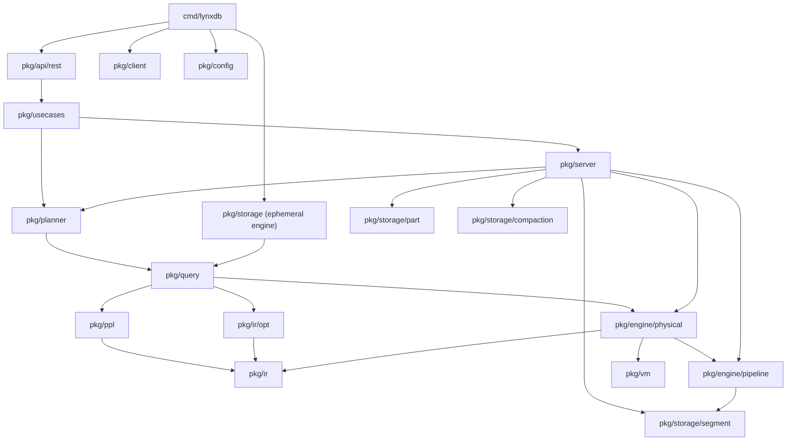

# Project Structure

LynxDB follows the standard Go project layout. This page describes each package and its role.

## Top-Level Layout

```
lynxdb/
├── cmd/            # Binaries: the lynxdb CLI and a segment fixture generator
├── pkg/            # Core packages
├── internal/       # Packages private to the module
├── test/           # End-to-end, CLI and regression tests
├── testdata/       # Sample logs and fixtures
├── scripts/        # Install, release and benchmark helper scripts
├── docs/           # Documentation site (Docusaurus) and format documents
├── go.mod, go.sum  # Module definition
├── mise.toml       # Pinned toolchain (Go, golangci-lint, goreleaser, ...)
└── Makefile        # Build, test and lint targets
```

## `cmd/`

### `cmd/lynxdb/` -- CLI

The `main` package and the CLI commands, built with Cobra:

| File | Command |
|------|---------|
| `root.go`, `main.go` | Root command, global flags, exit codes |
| `server.go` | `lynxdb server` |
| `query.go` | `lynxdb query` (server mode, and file and pipe mode in process) |
| `explain.go` | `lynxdb explain` |
| `tail.go` | `lynxdb tail` |
| `fields.go` | `lynxdb fields` |
| `ingest.go`, `import.go` | `lynxdb ingest`, `lynxdb import` |
| `status.go` | `lynxdb status`, `health`, `indexes`, `cache` |
| `jobs.go` | `lynxdb jobs` |
| `config.go` | `lynxdb config` and its subcommands |
| `authcmd.go`, `login.go`, `logout.go` | `lynxdb auth`, `login`, `logout` |
| `completion.go`, `completions.go` | Shell completion |
| `version.go` | `lynxdb version` |

This layer parses flags, loads configuration, and calls into `pkg/`. `CLI.md` in the directory documents the CLI conventions.

### `cmd/lsg-fixture/`

Writes the `.lsg` segment fixtures under `testdata/segments` that format compatibility tests read.

## `pkg/` -- Query Language and Planning

### `pkg/ppl/` -- PPL Frontend

Compiles OpenSearch Piped Processing Language into the IR.

```
pkg/ppl/
├── lexer/        # Tokens with line and column, following the official PPL lexer rules
├── parser/       # Hand-written recursive-descent parser
├── ast/          # Syntax tree with source spans
├── grok/         # Grok pattern library, expanded to RE2 at compile time
├── compile.go    # Entry point: parse, analyze, lower, validate
├── commands.go, commands_more.go, chart.go, join.go, search.go, exprs.go, timespec.go
│                 # Semantic analysis and lowering of each command and expression
├── catalog.go    # Command catalog: support level and notes per command
├── functions.go, relevance.go   # Scalar function catalog
├── aggs.go       # Aggregation catalog
└── errors.go     # Structured errors with codes, positions and hints
```

See [PPL architecture](../ppl/architecture.md), [Adding commands](../ppl/adding-commands.md) and [Adding functions](../ppl/adding-functions.md).

### `pkg/ir/` -- Intermediate Representation

The typed, language-independent plan: operators, expressions, schemas, types, the function registry, validation (`ir.Validate`), walking, and rendering for `explain`. See [PPL IR](../ppl/ir.md).

### `pkg/ir/opt/` -- Optimizer

Rule-based rewrites over IR plans (`fold-constants`, `merge-filters`, `remove-true-filter`, `prune-scan`, `time-range-to-scan`, `sort-limit-to-topn`, `limit-into-scan`) and column pruning. See [PPL optimizer](../ppl/optimizer.md).

### `pkg/query/` -- Compile and Run

The single entry point that turns query text into results: `Compile` (frontend, optimizer, plan cache), `Run` over an in-memory event store, and `Explain`.

### `pkg/planner/` -- Server-Side Planning

Wraps `query.Compile` for the server: storage hints, request time bounds, result-cache eligibility, and validation of live tail plans.

## `pkg/` -- Execution

### `pkg/engine/physical/` -- Physical Planner

Turns IR operators into pipeline iterators, compiles IR expressions to VM programs, evaluates uncorrelated subqueries, and derives storage hints from scans (`hints.go`, `source.go`).

### `pkg/engine/pipeline/` -- Volcano Iterators

The iterator interface (`Init`, `Next`, `Close`) and the operators: scans (`segment_stream.go` for server segments, `rowscan.go`, `livescan.go` for live tail), filter and eval, aggregation with spill (`aggregate.go`, `spill*.go`), sort and top-N, joins, unions, dedup, window operators (`eventstats.go`, `streamstats.go`), extraction, and the memory coordinator. Batches hold up to 1024 rows.

### `pkg/vm/` -- Bytecode VM

Compiles IR expressions to bytecode (`ir_compiler.go`) and runs them on a fixed 256-slot stack, with native implementations of every function in the IR registry.

### `pkg/engine/unpack/` -- Log Format Parsers

Field extractors for common log formats (combined, syslog, docker, JSON, logfmt, key=value, CEF, LEEF, W3C, and others), used by the CLI's ephemeral engine while loading files and by the pipeline's unpack iterator.

### `pkg/engine/columnar/`, `pkg/colstore/`, `pkg/vec/`, `pkg/mem/` -- Columnar Store

A columnar table store and a block-at-a-time executor for IR plans:

```
pkg/colstore/
├── part/         # Immutable columnar parts: blocks plus an indexing footer
├── shred/        # JSON documents parsed straight into typed column builders
├── variant/      # Binary encoding for JSON values without a column of their own
├── tokenfilter/  # Search tokens and split-block Bloom filters per block
└── exec/         # Executor over table snapshots; exec/irplan plans IR onto it
```

`pkg/engine/columnar` runs IR plans over these tables, handing the parts it cannot run to the row operators of `pkg/engine/physical`. `pkg/vec` holds typed column vectors and kernels; `pkg/mem` holds region allocators and pools. The server and the CLI do not use this store; the JSONBench benchmarks in `pkg/colstore` exercise it.

## `pkg/` -- Server, Storage and Ingest

### `pkg/server/` -- Engine

The server `Engine`: ingest into the batcher, part flush and registration, segment handles, query execution over segments (`query.go`, `store.go`), async jobs, compaction loops, retention and system status.

### `pkg/usecases/` -- Application Services

Query and tail services between the REST handlers and the engine: planning, sync/async execution, result shaping, metadata queries.

### `pkg/api/rest/` -- HTTP API

The HTTP server: route registration (`server.go`), handlers for query, explain, jobs, tail, ingest, the Elasticsearch, OTLP and Splunk HEC protocols, fields, status, cache, config and auth, plus middleware and the response envelope. `pkg/api/apicontracts` holds request and response constants shared with the client.

### `pkg/storage/` -- Storage Engine

```
pkg/storage/
├── engine.go     # Ephemeral in-memory engine for CLI file and pipe mode
├── part/         # AsyncBatcher, part writer, filesystem-scanned registry, retention
├── segment/      # .lsg reader and writer; column/ encodings; index/ blooms, term index, range bitmaps
├── compaction/   # Leveled compaction planning and merging
├── format/       # FORMAT marker reading and writing
└── sources/      # Registry of source names for multi-source and glob queries
```

See [Storage Engine](/docs/architecture/storage-engine) and [Segment Format](/docs/architecture/segment-format).

### `pkg/ingest/` -- Ingest Path

```
pkg/ingest/
├── pipeline/     # Ingest stages: format detection, field extraction, timestamps, dedup
├── receiver/     # HTTP, Elasticsearch (eshttp), OTLP (otlphttp, otlpgrpc, otlpcommon), Splunk HEC, syslog
├── staging/      # Coalesces small shipper batches before the engine
└── limits/       # Request body size limits for shipper endpoints
```

### Shared Packages

| Package | Purpose |
|---------|---------|
| `pkg/event` | The `Event` type and typed `Value` |
| `pkg/model` | Shared types: storage hints, segment metadata, time bounds |
| `pkg/config` | Configuration cascade (flags > env > file > defaults), validation, hot reload |
| `pkg/memgov` | Process-wide memory governor with memory classes and per-query budgets |
| `pkg/stats` | Query execution statistics for the CLI, API and metrics |
| `pkg/auth` | API keys, credential files, TLS helpers |
| `pkg/client` | Typed Go client for the REST API, used by the CLI |
| `pkg/timerange` | Parsing of relative and absolute time ranges |

## `internal/`

| Package | Purpose |
|---------|---------|
| `internal/docgen` | Writes the generated PPL reference pages (`docs/site/docs/ppl/commands.md`, `functions.md`, `aggregations.md`) from the catalogs; run `go run ./internal/docgen` or `make docs-gen` |
| `internal/output` | Result formatters for the CLI (JSON, NDJSON, table, CSV, TSV, raw, ...) |
| `internal/ui` | CLI theme and rendering components |
| `internal/buildinfo` | Version, commit and build date injected with `-ldflags` |
| `internal/glob` | Glob matching (`*`, `**`, `?`, classes, braces) |

## `test/`

```
test/
├── e2e/          # Server tests over the REST API; e2e/shippers runs real shippers in containers
├── cli/          # Tests against the built binary: pipe and file mode, exit codes, goldens
└── regression/   # Query correctness regressions
```

- **E2E**: `make test-e2e`; shipper compatibility with `make test-compat` and the nightly [conformance matrix](/docs/operations/shipper-conformance).
- **CLI**: `make test-cli` builds the binary and runs `test/cli` with the `clitest` tag.
- **Regression**: each test pins a fixed bug.

## Dependency Graph



## Related

- [Development Setup](/docs/contributing/development-setup) -- build and run the project
- [Coding Guidelines](/docs/contributing/coding-guidelines) -- style conventions
- [Architecture Overview](/docs/architecture/overview) -- how the system fits together
